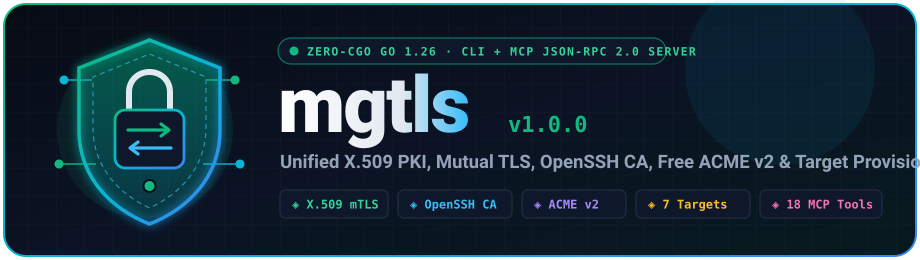
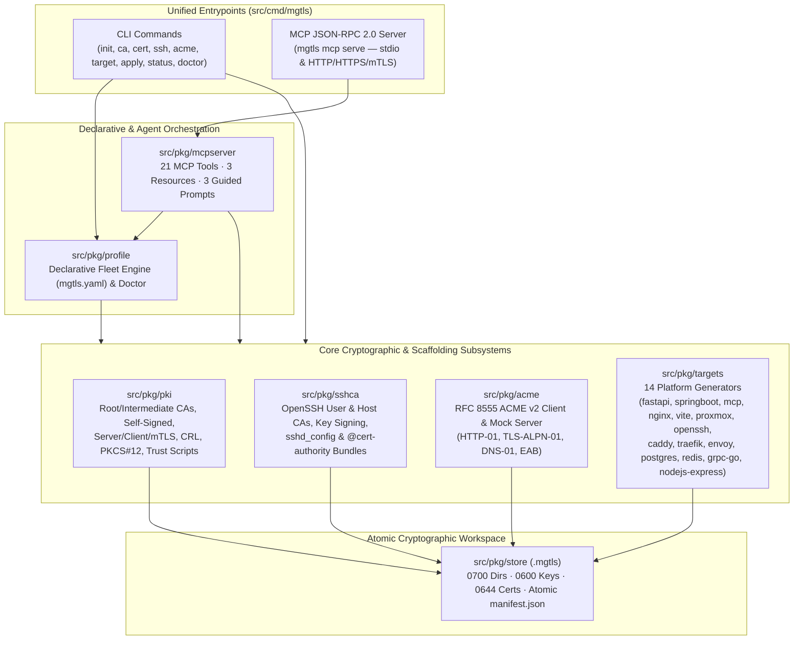

<div align="center">



<br />

[](https://github.com/bsommers/mgtls/releases/tag/v1.3.0)
[](https://go.dev/)
[](https://github.com/bsommers/mgtls)
[](https://bsommers.github.io/mgtls/#mcp)
[](LICENSE)
[](https://bsommers.github.io/mgtls/)

</div>

```text
   ╭──────────────────────────────────────────────────────────────────────────╮
   │               ▄▄▄▄███▄▄▄▄      ▄██████▄      ███      ▄█       ▄████████ │
   │             ▄██▀▀▀███▀▀▀██▄   ███    ███ ▀█████████▄ ███      ███    ███ │
   │    ╭───╮    ███   ███   ███   ███    █▀     ▀███▀▀██ ███      ███    █▀  │
   │   ╭┴───┴╮   ███   ███   ███  ▄███            ███   ▀ ███      ███        │
   │   │ ◈⇄◈ │   ███   ███   ███ ▀▀███ ████▄      ███     ███    ▀███████████ │
   │   ╰┬───┬╯   ███   ███   ███   ███    ███     ███     ███             ███ │
   │    ╰───╯    ███   ███   ███   ███    ███     ███     ███▌    ▄ ▄█    ███ │
   │     ╲ ╱      ▀█   ███   █▀    ████████▀     ▄████▀   █████▄▄██ ▄████████ │
   │      ▼                                               ▀                   │
   ├──────────────────────────────────────────────────────────────────────────┤
   │  X.509 Root/Int CA · Mutual TLS · OpenSSH CA · RFC 8555 ACME · MCP 2.0  │
   ╰──────────────────────────────────────────────────────────────────────────╯
```

# `mgtls` — Unified TLS, mTLS, Local/Public CA, OpenSSH Certificate & Target Provisioning Engine

## Purpose & Why `mgtls` Exists

### The Problem
Setting up **Mutual TLS (mTLS)**, **multi-tier Certificate Authorities (Root + Intermediate CAs)**, **OpenSSH Certificate Authorities**, and **free public ACME certificates** across modern polyglot stacks is notoriously tedious and error-prone:
- **Cryptographic Tool Sprawl**: Engineers have to juggle raw `openssl` commands, custom `.cnf` files for Subject Alternative Names (SANs) and Extended Key Usages (`serverAuth`/`clientAuth`), `keytool`/`pkcs12` conversions for Java, `ssh-keygen -s` flags for OpenSSH CAs, and `certbot`/`acme.sh` scripts for public certificates.
- **Framework Configuration Friction**: Even after generating `.pem` files, wiring strict mTLS verification into **Python FastAPI / Uvicorn**, **Spring Boot 3 REST APIs**, **Model Context Protocol (MCP) Servers**, **NGINX**, **Vite dev servers**, **Proxmox VE nodes**, and **OpenSSH daemons** requires memorizing different configuration schemas, SSL bundle formats, and client verification flags for every single tool.
- **AI Agent & Automation Blind Spot**: AI coding agents (Claude Code, Cursor, Antigravity) and IaC/CI-CD pipelines cannot safely or deterministically orchestrate ad-hoc `openssl` shell pipelines without risking broken certificate chains, missing SANs, or insecure private key permissions.

### The Purpose of `mgtls`
`mgtls` exists to turn **complex cryptographic infrastructure and mTLS service onboarding into a single, deterministic command**—callable by **humans via CLI**, by **IaC/CI-CD pipelines via declarative `mgtls.yaml` manifests**, and by **AI agents via a built-in Model Context Protocol (`mgtls mcp serve`) server**:

| Without `mgtls` (Manual Legacy Workflow) | With `mgtls` (Unified Zero-Trust Engine) |
| :--- | :--- |
| 15+ `openssl genrsa`, `req`, `x509 -extfile` commands to build a Root → Intermediate → Server/Client mTLS chain | `mgtls ca create` & `mgtls cert issue` (or 1-command `mgtls target generate <framework> --mtls`) |
| Hand-crafting framework-specific SSL configs for FastAPI, Spring Boot, MCP, NGINX, Vite, and Proxmox | Drop-in, runnable server + client configs, code snippets, and verification scripts generated automatically |
| Managing brittle `~/.ssh/authorized_keys` and TOFU `known_hosts` across server fleets | Built-in OpenSSH User & Host CA (`mgtls ssh ca-create`, `sign-user`, `sign-host`, `config`) |
| Separate ACME client tools for Let's Encrypt, ZeroSSL, Buypass, or Google Trust Services | Built-in RFC 8555 ACME v2 client supporting HTTP-01, TLS-ALPN-01, DNS-01, and External Account Binding (EAB) |
| Ad-hoc shell scripts executed by AI agents or CI runners | Native **MCP JSON-RPC 2.0 Server** (`mgtls mcp serve` over `stdio` or mTLS HTTPS) + declarative `mgtls apply -f mgtls.yaml` |

### Open-Source Ecosystem Capability Heatmap

See [`docs/architecture/ECOSYSTEM_COMPARISON.md`](docs/architecture/ECOSYSTEM_COMPARISON.md) for the full analysis:

```text
Legend:  ████ 100% (Full Native)   ▓▓░░ 50% (Partial / Plugin / Server-Only)   ░░░░ 0% (Not Supported)

╔════════════════════════════════╦════════════╦════════════╦════════════╦════════════╦════════════╦════════════╗
║                                ║   X.509    ║  OpenSSH   ║   Public   ║ App/Server ║Declarative ║   Native   ║
║  OPEN-SOURCE TOOL              ║ Multi-Tier ║ User/Host  ║  ACME v2   ║   mTLS     ║YAML Fleet  ║ MCP Server ║
║                                ║ PKI & mTLS ║     CA     ║  Client    ║Scaffolding ║  (GitOps)  ║ (AI Agent) ║
╠════════════════════════════════╬════════════╬════════════╬════════════╬════════════╬════════════╬════════════╣
║  mgtls (Go 1.26, 0-CGO)        ║ ████  100% ║ ████  100% ║ ████  100% ║ ████  100% ║ ████  100% ║ ████  100% ║
╟────────────────────────────────╫────────────╫────────────╫────────────╫────────────╫────────────╫────────────╢
║  Smallstep (step-cli / step-ca)║ ████  100% ║ ████  100% ║ ████  100% ║ ░░░░    0% ║ ░░░░    0% ║ ░░░░    0% ║
╟────────────────────────────────╫────────────╫────────────╫────────────╫────────────╫────────────╫────────────╢
║  HashiCorp Vault / OpenBao     ║ ████  100% ║ ████  100% ║ ▓▓░░   50% ║ ░░░░    0% ║ ▓▓░░   50% ║ ▓▓░░   50% ║
╟────────────────────────────────╫────────────╫────────────╫────────────╫────────────╫────────────╫────────────╢
║  Cloudflare cfssl              ║ ████  100% ║ ░░░░    0% ║ ░░░░    0% ║ ░░░░    0% ║ ▓▓░░   50% ║ ░░░░    0% ║
╟────────────────────────────────╫────────────╫────────────╫────────────╫────────────╫────────────╫────────────╢
║  Square certstrap              ║ ████  100% ║ ░░░░    0% ║ ░░░░    0% ║ ░░░░    0% ║ ░░░░    0% ║ ░░░░    0% ║
╟────────────────────────────────╫────────────╫────────────╫────────────╫────────────╫────────────╫────────────╢
║  OpenVPN easy-rsa              ║ ████  100% ║ ░░░░    0% ║ ░░░░    0% ║ ░░░░    0% ║ ░░░░    0% ║ ░░░░    0% ║
╟────────────────────────────────╫────────────╫────────────╫────────────╫────────────╫────────────╫────────────╢
║  FiloSottile mkcert            ║ ▓▓░░   50% ║ ░░░░    0% ║ ░░░░    0% ║ ░░░░    0% ║ ░░░░    0% ║ ░░░░    0% ║
╟────────────────────────────────╫────────────╫────────────╫────────────╫────────────╫────────────╫────────────╢
║  lego / certbot / acme.sh      ║ ░░░░    0% ║ ░░░░    0% ║ ████  100% ║ ▓▓░░   50% ║ ░░░░    0% ║ ░░░░    0% ║
╚════════════════════════════════╩════════════╩════════════╩════════════╩════════════╩════════════╩════════════╝

  Overall Ecosystem Coverage Score (out of 6 Core Dimensions):
  ──────────────────────────────────────────────────────────────────────────────
  mgtls                     ████████████████████████████████████  6.0 / 6.0 (100%)
  HashiCorp Vault / OpenBao █████████████████████░░░░░░░░░░░░░░░  3.5 / 6.0  (58%)
  Smallstep (step-cli/ca)   ██████████████████░░░░░░░░░░░░░░░░░░  3.0 / 6.0  (50%)
  Cloudflare cfssl          █████████░░░░░░░░░░░░░░░░░░░░░░░░░░░  1.5 / 6.0  (25%)
  lego / certbot / acme.sh  █████████░░░░░░░░░░░░░░░░░░░░░░░░░░░  1.5 / 6.0  (25%)
  Square certstrap          ██████░░░░░░░░░░░░░░░░░░░░░░░░░░░░░░  1.0 / 6.0  (17%)
  OpenVPN easy-rsa          ██████░░░░░░░░░░░░░░░░░░░░░░░░░░░░░░  1.0 / 6.0  (17%)
  FiloSottile mkcert        ███░░░░░░░░░░░░░░░░░░░░░░░░░░░░░░░░░  0.5 / 6.0   (8%)
```

### Who Should Use `mgtls` & Common Use Cases
1. **API & Microservice Developers (FastAPI, Spring Boot, Vite, NGINX)**: Stand up local or production mutual TLS (mTLS) between backend APIs, reverse proxies, and frontend dev servers in seconds, complete with working client certificate validation code.
2. **AI Agent & MCP Server Builders**: Secure local or remote **Model Context Protocol (MCP)** servers with strict client-certificate mTLS, and give AI agents direct access to `mgtls` via `mgtls mcp serve` to provision certificates autonomously.
3. **Homelab & Infrastructure Admins (Proxmox VE, OpenSSH Fleets)**: Replace Proxmox VE self-signed browser warnings with trusted CA chains or automated ACME certificates, and replace static SSH keys with short-lived OpenSSH User & Host certificates.
4. **DevSecOps, IaC & CI/CD Pipelines (Terraform, Ansible, GitHub Actions, GitLab CI)**: Version-control your entire PKI, SSH CA, and target topology in `mgtls.yaml`, reconcile it idempotently with `mgtls apply`, and audit key permissions (`0600`) and certificate expiry with `mgtls doctor`.

---

## About

`mgtls` is a zero-CGO (`CGO_ENABLED=0`), single-binary Go 1.26 cryptographic authority, certificate lifecycle engine, and **Model Context Protocol (MCP)** server (`mgtls mcp serve`) built for developers, platform engineers, and autonomous AI agents. It unifies local multi-tier X.509 PKI, mutual TLS (mTLS), OpenSSH User & Host Certificate Authorities, free public RFC 8555 ACME v2 encryption, and drop-in configuration generation across 14 target platforms (`FastAPI`, `Spring Boot 3`, `MCP Server`, `NGINX`, `Vite`, `Proxmox VE`, `OpenSSH`, `Caddy`, `Traefik`, `Envoy`, `PostgreSQL`, `Redis`, `gRPC-Go`, and `Node.js/Express`):

- **Multi-Tier X.509 PKI & Mutual TLS (mTLS)**: Root CAs, Intermediate CA chains (`fullchain.pem`, `ca-chain.pem`), standalone self-signed certificates, Server/Client/Dual-mTLS leaf certificates, PKCS#12 (`.p12`) & DER bundles, X.509 v2 CRLs, and OS trust store installers.
- **OpenSSH Certificate Authorities**: Dedicated OpenSSH User CAs (`SSH_CERT_TYPE_USER`) and Host CAs (`SSH_CERT_TYPE_HOST`), Ed25519/ECDSA/RSA keypair generation, principal/validity/extension signing (`*-cert.pub`), certificate inspection, and automated `sshd_config`, `ssh_config`, `authorized_principals`, and `@cert-authority` `known_hosts` bundles.
- **Public Free Encryption via RFC 8555 ACME v2**: Built-in support for **Let's Encrypt** (Production & Staging), **ZeroSSL** (with EAB), **Buypass Go SSL**, **Google Trust Services** (with EAB), and custom ACME v2 directories (`HTTP-01`, `TLS-ALPN-01`, and `DNS-01` challenges), plus an in-memory RFC 8555 mock server for offline testing.
- **Drop-In Framework & Infrastructure Scaffolding**: Ready-to-run TLS 1.3 and mTLS configurations, server/client code templates, and verification harnesses for **Python FastAPI**, **Spring Boot 3**, **Model Context Protocol (MCP) Servers**, **NGINX**, **Vite**, **Proxmox VE**, and **OpenSSH**.
- **Declarative Fleet Management & Health Auditing**: Idempotent reconciliation via `mgtls apply -f mgtls.yaml`, inventory reporting (`mgtls status`), and automated key-permission (`0600`) and expiry auditing (`mgtls doctor`).

---

## System Architecture



---

## Quickstart

### 1. Install `mgtls` (One-Line Installer, Local Build, or Container)

```bash
# Option A: Install to ~/.local/bin (unprivileged default) or custom prefix
./install.sh --local
# Or download & SHA-256 verify prebuilt release binary:
curl -fsSL https://bsommers.github.io/mgtls/install.sh | bash -s -- --from-release

# Option B: Build the zero-CGO static binary directly
CGO_ENABLED=0 go build -trimpath -ldflags="-s -w" -o bin/mgtls ./src/cmd/mgtls

# Option C: Build minimal scratch container image
docker build -t mgtls:latest .
```

### 2. Zero-State Onboarding (`init` $\rightarrow$ `doctor` $\rightarrow$ `apply` $\rightarrow$ `guide`)

```bash
# Initialize .mgtls workspace, Root CA, and starter mgtls.yaml manifest
mgtls init --with-root-ca --starter --yes

# Reconcile starter fleet and audit health/key permissions
mgtls apply -f mgtls.yaml
mgtls doctor
mgtls guide
```

### 3. Imperative CLI Workflow (Root CA → Intermediate CA → mTLS Certificates → FastAPI Bundle)

```bash
# Initialize workspace (.mgtls)
./bin/mgtls init

# Create Root CA and Intermediate CA
./bin/mgtls ca create --name corp-root-ca --cn "Acme Corp Root CA" --algo ed25519 --days 3650
./bin/mgtls ca create --name corp-intermediate-ca --parent corp-root-ca --cn "Acme Corp Intermediate CA" --algo ecdsa-p256 --days 1825

# Issue Server and Client mTLS certificates
./bin/mgtls cert issue --name api-srv --ca corp-intermediate-ca --cn localhost --role server --dns "localhost,api.internal" --ip "127.0.0.1"
./bin/mgtls cert issue --name api-client --ca corp-intermediate-ca --cn billing-worker --role client --uri "spiffe://corp.internal/sa/billing"

# Verify chain and generate a complete FastAPI mTLS bundle
./bin/mgtls cert verify --cert .mgtls/certs/api-srv/cert.pem --ca .mgtls/certs/api-srv/ca-chain.pem --dns localhost --role server
./bin/mgtls target generate --type fastapi --name fastapi-orders --ca corp-intermediate-ca --server-cert api-srv --client-cert api-client --mtls --out ./out-fastapi
```

### 3. Declarative Fleet Workflow (`mgtls.yaml`)

Provision an entire multi-tier X.509 PKI, OpenSSH CA fleet, and all 7 framework target bundles with a single command:

```bash
./bin/mgtls --store-dir .mgtls-fleet apply -f examples/fleet/mgtls.yaml
./bin/mgtls --store-dir .mgtls-fleet status
./bin/mgtls --store-dir .mgtls-fleet doctor --warn-days 30
```

### 4. Model Context Protocol (MCP) Server Workflow (`mgtls mcp serve`)

Run `mgtls` as an MCP Server over `stdio` (for Claude Desktop, Cursor, Windsurf) or over an **mTLS-authenticated HTTPS transport**:

```bash
# Standard I/O transport
./bin/mgtls --store-dir .mgtls mcp serve --transport stdio

# HTTPS + Mutual TLS transport
./bin/mgtls --store-dir .mgtls mcp serve \
  --transport http \
  --addr 127.0.0.1:8444 \
  --tls-cert .mgtls/certs/api-srv/fullchain.pem \
  --tls-key .mgtls/certs/api-srv/key.pem \
  --client-ca .mgtls/certs/api-srv/ca-chain.pem
```

---

## Supported Target Frameworks & Servers

| Target ID | Platform / Stack | Default Port | Generated Artifacts & Capabilities |
| :--- | :--- | :--- | :--- |
| `fastapi` | **Python FastAPI + Uvicorn + `httpx`** | `8443` | `app.py` (ASGI peer cert extraction), `run_server.sh`, `client_mtls.py` (`httpx` SSLContext), `verify_mtls.sh` |
| `springboot` | **Spring Boot 3.2+ REST API & `RestClient`** | `8443` | `application-tls.yml` (PEM SSL bundles, `client-auth: need`), `MtlsSecurityConfig.java`, `MtlsRestClientConfig.java`, `verify_mtls.sh` |
| `mcp` | **Model Context Protocol (MCP) Server & Client** | `8444` | `mcp_server_mtls.ts`, `mcp_server_mtls.py`, `mcp_client_config.json`, `nginx_mcp_sidecar.conf`, `verify_mcp_mtls.sh` |
| `nginx` | **NGINX TLS 1.3 & mTLS Reverse Proxy** | `443` | `nginx-mtls.conf` (`ssl_verify_client on`, `$ssl_client_s_dn` upstream headers), `verify_nginx_mtls.sh` |
| `vite` | **Vite HTTPS & mTLS Dev/Preview Server** | `5173` | `vite.config.mtls.ts` (`node:https` `requestCert: true`, `rejectUnauthorized: true`), `client_fetch_mtls.mjs` |
| `proxmox` | **Proxmox VE Node (`pveproxy`)** | `8006` | `deploy_proxmox_cert.sh` (`pvenode cert set` / `/etc/pve/local/pveproxy-ssl.pem`), `proxmox_pveproxy_verify.sh`, `README-proxmox.md` |
| `openssh` | **OpenSSH Server (`sshd`) & Client Fleet** | `22` | `sshd_ca.conf` (`TrustedUserCAKeys`, `HostCertificate`), `ssh_client_ca.conf` (`@cert-authority`), `deploy_ssh_ca.sh` |

---

## Built-In Free Public ACME v2 Providers (`pkg/acme`)

| Provider ID | Authority Name | Directory URL | EAB Required | Challenges Supported |
| :--- | :--- | :--- | :--- | :--- |
| `letsencrypt` | Let's Encrypt (Production) | `https://acme-v02.api.letsencrypt.org/directory` | No | `http-01`, `tls-alpn-01`, `dns-01` |
| `letsencrypt-staging` | Let's Encrypt (Staging) | `https://acme-staging-v02.api.letsencrypt.org/directory` | No | `http-01`, `tls-alpn-01`, `dns-01` |
| `zerossl` | ZeroSSL (90-Day Free DV) | `https://acme.zerossl.com/v2/DV90` | Yes (`--eab-kid`, `--eab-hmac-key`) | `http-01`, `dns-01` |
| `buypass` | Buypass Go SSL (180-Day Free DV) | `https://api.buypass.com/acme/directory` | No | `http-01`, `dns-01` |
| `google` | Google Trust Services | `https://dv.acme-v02.api.pki.goog/directory` | Yes (`--eab-kid`, `--eab-hmac-key`) | `http-01`, `tls-alpn-01`, `dns-01` |
| `custom` | Custom RFC 8555 CA (Step-CA, Pebble) | Custom `--directory-url` | Optional | `http-01`, `tls-alpn-01`, `dns-01` |

---

## OpenSSH Certificate Authority Workflow (`pkg/sshca`)

```bash
# 1. Create dedicated OpenSSH User CA and Host CA
mgtls ssh ca-create --name corp-ssh-user-ca --type user --algo ed25519
mgtls ssh ca-create --name corp-ssh-host-ca --type host --algo ed25519

# 2. Sign a User Certificate (30-day validity, principals: alice,admin,sre)
mgtls ssh sign --name alice-ssh --ca corp-ssh-user-ca --type user \
  --key-id "alice@corp.internal" --principals "alice,admin,sre" --hours 720

# 3. Sign a Host Certificate (1-year validity, principals: bastion.corp.internal,10.0.0.10)
mgtls ssh sign --name bastion-host-ssh --ca corp-ssh-host-ca --type host \
  --key-id "bastion.corp.internal" --principals "bastion.corp.internal,10.0.0.10" --hours 8760

# 4. Generate complete sshd_config, ssh_config, authorized_principals & @cert-authority known_hosts
mgtls ssh config-bundle --name corp-ssh-fleet \
  --user-ca corp-ssh-user-ca --host-ca corp-ssh-host-ca \
  --user-cert alice-ssh --host-cert bastion-host-ssh \
  --hosts "*.corp.internal,10.0.0.*" --principals "alice,admin,sre" \
  --out ./openssh-fleet-bundle
```

---

## Documentation Index (`docs/`)

| Document | Path | Description |
| :--- | :--- | :--- |
| **GitHub Pages Site** | [`https://bsommers.github.io/mgtls/`](https://bsommers.github.io/mgtls/) | Interactive dark-mode documentation portal, quickstart tabs, target showcase, and MCP tool catalog |
| **System Architecture** | [`docs/architecture/SYSTEM_ARCHITECTURE.md`](docs/architecture/SYSTEM_ARCHITECTURE.md) | Layered architecture, component interaction diagrams, security model, and workspace layout |
| **Ecosystem Comparison & Heatmap** | [`docs/architecture/ECOSYSTEM_COMPARISON.md`](docs/architecture/ECOSYSTEM_COMPARISON.md) | Open-source comparison matrix & ASCII capability heatmap (`mgtls` vs `step-ca`, `Vault`, `cfssl`, `mkcert`, `certbot`) |
| **Cryptography & Protocol Spec** | [`docs/specs/CRYPTO_AND_PROTOCOL_SPEC.md`](docs/specs/CRYPTO_AND_PROTOCOL_SPEC.md) | X.509 v3 profile specifications, key usage matrices, OpenSSH cert format, and RFC 8555 ACME v2 state machine |
| **MCP Server Specification** | [`docs/specs/MCP_SERVER_SPEC.md`](docs/specs/MCP_SERVER_SPEC.md) | JSON-RPC 2.0 MCP tools, resources, prompts, schemas, and `stdio`/HTTPS-mTLS transport specifications |
| **User Guide & CLI Reference** | [`docs/user-guide/USER_GUIDE.md`](docs/user-guide/USER_GUIDE.md) | Complete CLI command reference, PKI lifecycle tutorials, and declarative `mgtls.yaml` guide |
| **OpenSSH CA & ACME Guide** | [`docs/user-guide/SSH_CA_AND_ACME_GUIDE.md`](docs/user-guide/SSH_CA_AND_ACME_GUIDE.md) | Production OpenSSH User/Host CA rollout guide and Let's Encrypt / ZeroSSL / Google Trust ACME automation |
| **Target Integrations Guide** | [`docs/user-guide/TARGETS_GUIDE.md`](docs/user-guide/TARGETS_GUIDE.md) | Deep-dive configuration guides for FastAPI, Spring Boot 3, MCP, NGINX, Vite, Proxmox VE, and OpenSSH |
| **Operational Cookbooks** | [`docs/cookbooks/COOKBOOKS.md`](docs/cookbooks/COOKBOOKS.md) | 5 end-to-end executable cookbook workflows (`cookbooks/*.sh`) with architectural diagrams |
| **IaC & CI/CD Integration Guide** | [`docs/cookbooks/IAC_AND_CICD_GUIDE.md`](docs/cookbooks/IAC_AND_CICD_GUIDE.md) | Terraform/OpenTofu, Ansible, Kubernetes TLS Secrets, Docker Compose, GitHub Actions, and GitLab CI |
| **Capabilities Manifest** | [`docs/CAPABILITIES.md`](docs/CAPABILITIES.md) | Machine-verifiable capabilities registry (`docs/capabilities.json`) and roadmap |
| **Test Coverage & Suite Report** | [`docs/TEST_COVERAGE.md`](docs/TEST_COVERAGE.md) | Instrumented coverage report (`83.2%`), P0/P1/P2 gap remediation, E2E example/cookbook matrix, and Shell Test-Quality Checklist |
| **5-Axis Code Review & Audit** | [`docs/CODE_REVIEW.md`](docs/CODE_REVIEW.md) | Multi-axis code review (Correctness, Readability, Architecture, Security, Performance), severity-labeled findings, and security hardening verification |
| **Forward Roadmap (`v1.3.0+`)** | [`docs/ROADMAP.md`](docs/ROADMAP.md) | Completed `v1.2.0` & `v1.3.0` capability milestones (OCSP responder/verifier, TLS/mTLS prober, PKCS#10 CSR signing, encrypted key vault) and upcoming roadmap |
| **Changelog** | [`docs/CHANGELOG.md`](docs/CHANGELOG.md) | Release history and verification telemetry |

---

## Executable Cookbooks & IaC / CI-CD Flows (`cookbooks/`)

| Cookbook / Template | Path | Description |
| :--- | :--- | :--- |
| **Cookbook 01: Local PKI & mTLS Mesh** | [`cookbooks/01-local-pki-and-mtls-mesh.sh`](cookbooks/01-local-pki-and-mtls-mesh.sh) | Offline Root CA → Intermediate CA → Server/Client mTLS certs → FastAPI, Spring Boot, NGINX & Vite bundles |
| **Cookbook 02: Zero-Trust MCP Agent** | [`cookbooks/02-mcp-agent-zero-trust-mtls.sh`](cookbooks/02-mcp-agent-zero-trust-mtls.sh) | Live JSON-RPC 2.0 session against `mgtls mcp serve` provisioning MCP Server & Client mTLS bundles |
| **Cookbook 03: OpenSSH CA Fleet** | [`cookbooks/03-openssh-zero-trust-ca-fleet.sh`](cookbooks/03-openssh-zero-trust-ca-fleet.sh) | OpenSSH User CA & Host CA creation, principal key signing, inspection, and `@cert-authority` fleet bundle |
| **Cookbook 04: Proxmox & ACME v2** | [`cookbooks/04-proxmox-and-acme-automation.sh`](cookbooks/04-proxmox-and-acme-automation.sh) | Proxmox VE (`pveproxy`) node TLS bundle + Let's Encrypt / ZeroSSL / Buypass / Google Trust ACME matrix |
| **Cookbook 05: IaC & CI/CD Secrets** | [`cookbooks/05-iac-and-cicd-integration.sh`](cookbooks/05-iac-and-cicd-integration.sh) | Reconciles `mgtls.yaml`, exports Kubernetes `kubernetes.io/tls` Secrets, Terraform JSON, and runs `doctor` |
| **Terraform / OpenTofu Bridge** | [`cookbooks/iac-cicd/terraform/`](cookbooks/iac-cicd/terraform) | `main.tf` + `mgtls-external.sh` (`hashicorp/external` data source bridge) |
| **Ansible Fleet Playbook** | [`cookbooks/iac-cicd/ansible/site.yml`](cookbooks/iac-cicd/ansible/site.yml) | Automated fleet reconciliation, `doctor` gate, and OpenSSH CA distribution playbook |
| **Docker Compose mTLS Stack** | [`cookbooks/iac-cicd/docker-compose/docker-compose.mtls.yml`](cookbooks/iac-cicd/docker-compose/docker-compose.mtls.yml) | Containerized NGINX mTLS reverse proxy + `mgtls mcp serve --transport http` mTLS server |
| **CI/CD Pipeline Templates** | [`cookbooks/cicd/`](cookbooks/cicd) | Reusable GitHub Actions (`github-actions-mgtls.yml`) and GitLab CI (`gitlab-ci-mgtls.yml`) templates |

---

## Runnable Example Use Cases (`examples/`)

| Example Directory | Key Files | Description |
| :--- | :--- | :--- |
| [`examples/fleet/`](examples/fleet) | [`mgtls.yaml`](examples/fleet/mgtls.yaml) | Full declarative multi-tier manifest (Root CA, Intermediate CA, Self-Signed, all 7 platform certs, OpenSSH User/Host CAs & certs, and all 7 target outputs) |
| [`examples/fastapi-mtls/`](examples/fastapi-mtls) | [`README.md`](examples/fastapi-mtls/README.md), [`server.py`](examples/fastapi-mtls/server.py), [`client.py`](examples/fastapi-mtls/client.py), [`setup_and_test.sh`](examples/fastapi-mtls/setup_and_test.sh) | FastAPI + Uvicorn mTLS server extracting peer X.509 certificate attributes and `httpx` mTLS client |
| [`examples/springboot-mtls/`](examples/springboot-mtls) | [`README.md`](examples/springboot-mtls/README.md), [`application.yml`](examples/springboot-mtls/application.yml), [`MtlsController.java`](examples/springboot-mtls/MtlsController.java), [`setup_springboot_mtls.sh`](examples/springboot-mtls/setup_springboot_mtls.sh) | Spring Boot 3.2+ native PEM SSL bundles (`client-auth: need`), Spring Security X.509 filter, and mTLS `RestClient` |
| [`examples/mcp-mtls/`](examples/mcp-mtls) | [`README.md`](examples/mcp-mtls/README.md), [`mcp_server.py`](examples/mcp-mtls/mcp_server.py), [`claude_desktop_config.json`](examples/mcp-mtls/claude_desktop_config.json), [`setup_mcp_mtls.sh`](examples/mcp-mtls/setup_mcp_mtls.sh) | MCP JSON-RPC 2.0 server protected by mTLS and client configuration for both `mgtls mcp serve` (`stdio`) and remote mTLS MCP |
| [`examples/nginx-mtls/`](examples/nginx-mtls) | [`README.md`](examples/nginx-mtls/README.md), [`nginx.conf`](examples/nginx-mtls/nginx.conf), [`setup_nginx_mtls.sh`](examples/nginx-mtls/setup_nginx_mtls.sh) | NGINX TLS 1.3 reverse proxy with `ssl_verify_client on` and `$ssl_client_s_dn` identity headers |
| [`examples/vite-mtls/`](examples/vite-mtls) | [`README.md`](examples/vite-mtls/README.md), [`vite.config.ts`](examples/vite-mtls/vite.config.ts), [`setup_vite_mtls.sh`](examples/vite-mtls/setup_vite_mtls.sh) | Vite HTTPS + mTLS dev/preview server with `node:tls` peer certificate inspection middleware |
| [`examples/proxmox-tls/`](examples/proxmox-tls) | [`README.md`](examples/proxmox-tls/README.md), [`setup_proxmox_tls.sh`](examples/proxmox-tls/setup_proxmox_tls.sh) | Proxmox VE node certificate deployment (`/etc/pve/local/pveproxy-ssl.pem` / `pvenode cert set`) & Let's Encrypt ACME automation |
| [`examples/openssh-ca/`](examples/openssh-ca) | [`README.md`](examples/openssh-ca/README.md), [`setup_openssh_ca.sh`](examples/openssh-ca/setup_openssh_ca.sh) | End-to-end OpenSSH User CA & Host CA provisioning, key signing, `sshd_config`, `authorized_principals`, and `@cert-authority` `known_hosts` |
