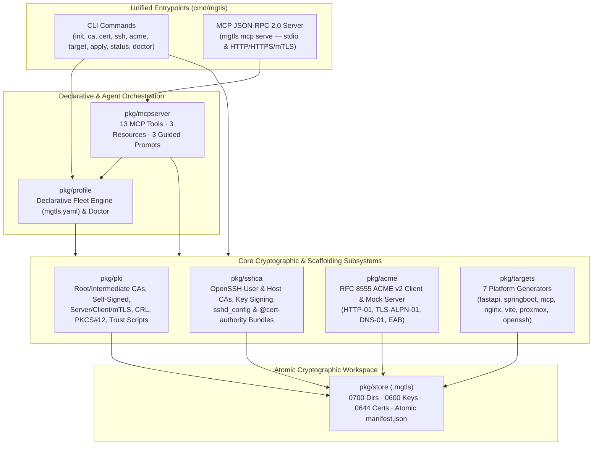

# `mgtls` — Unified TLS, mTLS, Local/Public CA, OpenSSH Certificate & Target Provisioning Engine

`mgtls` is a single-binary, pure-Go (`go1.26`, `CGO_ENABLED=0`) cryptographic orchestration CLI and **Model Context Protocol (MCP)** server (`mgtls mcp serve`) that provisions and manages:

- **Multi-Tier X.509 PKI & Mutual TLS (mTLS)**: Root CAs, Intermediate CA chains (`fullchain.pem`, `ca-chain.pem`), standalone self-signed certificates, Server/Client/Dual-mTLS leaf certificates, PKCS#12 (`.p12`) & DER bundles, X.509 v2 CRLs, and OS trust store installers.
- **OpenSSH Certificate Authorities**: Dedicated OpenSSH User CAs (`SSH_CERT_TYPE_USER`) and Host CAs (`SSH_CERT_TYPE_HOST`), Ed25519/ECDSA/RSA keypair generation, principal/validity/extension signing (`*-cert.pub`), certificate inspection, and automated `sshd_config`, `ssh_config`, `authorized_principals`, and `@cert-authority` `known_hosts` bundles.
- **Public Free Encryption via RFC 8555 ACME v2**: Built-in support for **Let's Encrypt** (Production & Staging), **ZeroSSL** (with EAB), **Buypass Go SSL**, **Google Trust Services** (with EAB), and custom ACME v2 directories (`HTTP-01`, `TLS-ALPN-01`, and `DNS-01` challenges), plus an in-memory RFC 8555 mock server for offline testing.
- **Drop-In Framework & Infrastructure Scaffolding**: Ready-to-run TLS 1.3 and mTLS configurations, server/client code templates, and verification harnesses for **Python FastAPI**, **Spring Boot 3**, **Model Context Protocol (MCP) Servers**, **NGINX**, **Vite**, **Proxmox VE**, and **OpenSSH**.
- **Declarative Fleet Management & Health Auditing**: Idempotent reconciliation via `mgtls apply -f mgtls.yaml`, inventory reporting (`mgtls status`), and automated key-permission (`0600`) and expiry auditing (`mgtls doctor`).

---

## System Architecture



---

## Quickstart

### 1. Build the Static Binary

```bash
CGO_ENABLED=0 go build -trimpath -ldflags="-s -w" -o bin/mgtls ./cmd/mgtls
```

### 2. Imperative CLI Workflow (Root CA → Intermediate CA → mTLS Certificates → FastAPI Bundle)

```bash
# Initialize workspace (.mgtls)
./bin/mgtls init

# Create Root CA and Intermediate CA
./bin/mgtls ca create --name corp-root-ca --cn "Acme Corp Root CA" --algo ed25519 --days 3650
./bin/mgtls ca create --name corp-intermediate-ca --parent corp-root-ca --cn "Acme Corp Intermediate CA" --algo ecdsa-p256 --days 1825

# Issue Server and Client mTLS certificates
./bin/mgtls cert issue --name api-srv --ca corp-intermediate-ca --cn localhost --role server --dns "localhost,api.internal" --ip "127.0.0.1"
./bin/mgtls cert issue --name api-client --ca corp-intermediate-ca --cn billing-worker --role client --uri "spiffe://corp.internal/sa/billing"

# Verify chain and generate a complete FastAPI mTLS bundle
./bin/mgtls cert verify --cert .mgtls/certs/api-srv/cert.pem --ca .mgtls/certs/api-srv/ca-chain.pem --dns localhost --role server
./bin/mgtls target generate --type fastapi --name fastapi-orders --ca corp-intermediate-ca --server-cert api-srv --client-cert api-client --mtls --out ./out-fastapi
```

### 3. Declarative Fleet Workflow (`mgtls.yaml`)

Provision an entire multi-tier X.509 PKI, OpenSSH CA fleet, and all 7 framework target bundles with a single command:

```bash
./bin/mgtls --store-dir .mgtls-fleet apply -f examples/fleet/mgtls.yaml
./bin/mgtls --store-dir .mgtls-fleet status
./bin/mgtls --store-dir .mgtls-fleet doctor --warn-days 30
```

### 4. Model Context Protocol (MCP) Server Workflow (`mgtls mcp serve`)

Run `mgtls` as an MCP Server over `stdio` (for Claude Desktop, Cursor, Windsurf) or over an **mTLS-authenticated HTTPS transport**:

```bash
# Standard I/O transport
./bin/mgtls --store-dir .mgtls mcp serve --transport stdio

# HTTPS + Mutual TLS transport
./bin/mgtls --store-dir .mgtls mcp serve \
  --transport http \
  --addr 127.0.0.1:8444 \
  --tls-cert .mgtls/certs/api-srv/fullchain.pem \
  --tls-key .mgtls/certs/api-srv/key.pem \
  --client-ca .mgtls/certs/api-srv/ca-chain.pem
```

---

## Supported Target Frameworks & Servers

| Target ID | Platform / Stack | Default Port | Generated Artifacts & Capabilities |
| :--- | :--- | :--- | :--- |
| `fastapi` | **Python FastAPI + Uvicorn + `httpx`** | `8443` | `app.py` (ASGI peer cert extraction), `run_server.sh`, `client_mtls.py` (`httpx` SSLContext), `verify_mtls.sh` |
| `springboot` | **Spring Boot 3.2+ REST API & `RestClient`** | `8443` | `application-tls.yml` (PEM SSL bundles, `client-auth: need`), `MtlsSecurityConfig.java`, `MtlsRestClientConfig.java`, `verify_mtls.sh` |
| `mcp` | **Model Context Protocol (MCP) Server & Client** | `8444` | `mcp_server_mtls.ts`, `mcp_server_mtls.py`, `mcp_client_config.json`, `nginx_mcp_sidecar.conf`, `verify_mcp_mtls.sh` |
| `nginx` | **NGINX TLS 1.3 & mTLS Reverse Proxy** | `443` | `nginx-mtls.conf` (`ssl_verify_client on`, `$ssl_client_s_dn` upstream headers), `verify_nginx_mtls.sh` |
| `vite` | **Vite HTTPS & mTLS Dev/Preview Server** | `5173` | `vite.config.mtls.ts` (`node:https` `requestCert: true`, `rejectUnauthorized: true`), `client_fetch_mtls.mjs` |
| `proxmox` | **Proxmox VE Node (`pveproxy`)** | `8006` | `deploy_proxmox_cert.sh` (`pvenode cert set` / `/etc/pve/local/pveproxy-ssl.pem`), `proxmox_pveproxy_verify.sh`, `README-proxmox.md` |
| `openssh` | **OpenSSH Server (`sshd`) & Client Fleet** | `22` | `sshd_ca.conf` (`TrustedUserCAKeys`, `HostCertificate`), `ssh_client_ca.conf` (`@cert-authority`), `deploy_ssh_ca.sh` |

---

## Built-In Free Public ACME v2 Providers (`pkg/acme`)

| Provider ID | Authority Name | Directory URL | EAB Required | Challenges Supported |
| :--- | :--- | :--- | :--- | :--- |
| `letsencrypt` | Let's Encrypt (Production) | `https://acme-v02.api.letsencrypt.org/directory` | No | `http-01`, `tls-alpn-01`, `dns-01` |
| `letsencrypt-staging` | Let's Encrypt (Staging) | `https://acme-staging-v02.api.letsencrypt.org/directory` | No | `http-01`, `tls-alpn-01`, `dns-01` |
| `zerossl` | ZeroSSL (90-Day Free DV) | `https://acme.zerossl.com/v2/DV90` | Yes (`--eab-kid`, `--eab-hmac-key`) | `http-01`, `dns-01` |
| `buypass` | Buypass Go SSL (180-Day Free DV) | `https://api.buypass.com/acme/directory` | No | `http-01`, `dns-01` |
| `google` | Google Trust Services | `https://dv.acme-v02.api.pki.goog/directory` | Yes (`--eab-kid`, `--eab-hmac-key`) | `http-01`, `tls-alpn-01`, `dns-01` |
| `custom` | Custom RFC 8555 CA (Step-CA, Pebble) | Custom `--directory-url` | Optional | `http-01`, `tls-alpn-01`, `dns-01` |

---

## OpenSSH Certificate Authority Workflow (`pkg/sshca`)

```bash
# 1. Create dedicated OpenSSH User CA and Host CA
mgtls ssh ca-create --name corp-ssh-user-ca --type user --algo ed25519
mgtls ssh ca-create --name corp-ssh-host-ca --type host --algo ed25519

# 2. Sign a User Certificate (30-day validity, principals: alice,admin,sre)
mgtls ssh sign --name alice-ssh --ca corp-ssh-user-ca --type user \
  --key-id "alice@corp.internal" --principals "alice,admin,sre" --hours 720

# 3. Sign a Host Certificate (1-year validity, principals: bastion.corp.internal,10.0.0.10)
mgtls ssh sign --name bastion-host-ssh --ca corp-ssh-host-ca --type host \
  --key-id "bastion.corp.internal" --principals "bastion.corp.internal,10.0.0.10" --hours 8760

# 4. Generate complete sshd_config, ssh_config, authorized_principals & @cert-authority known_hosts
mgtls ssh config-bundle --name corp-ssh-fleet \
  --user-ca corp-ssh-user-ca --host-ca corp-ssh-host-ca \
  --user-cert alice-ssh --host-cert bastion-host-ssh \
  --hosts "*.corp.internal,10.0.0.*" --principals "alice,admin,sre" \
  --out ./openssh-fleet-bundle
```

---

## Documentation Index (`docs/`)

| Document | Path | Description |
| :--- | :--- | :--- |
| **System Architecture** | [`docs/architecture/SYSTEM_ARCHITECTURE.md`](file:///home/bill/src/sysadmin/mgtls/docs/architecture/SYSTEM_ARCHITECTURE.md) | Layered architecture, component interaction diagrams, security model, and workspace layout |
| **Cryptography & Protocol Spec** | [`docs/specs/CRYPTO_AND_PROTOCOL_SPEC.md`](file:///home/bill/src/sysadmin/mgtls/docs/specs/CRYPTO_AND_PROTOCOL_SPEC.md) | X.509 v3 profile specifications, key usage matrices, OpenSSH cert format, and RFC 8555 ACME v2 state machine |
| **MCP Server Specification** | [`docs/specs/MCP_SERVER_SPEC.md`](file:///home/bill/src/sysadmin/mgtls/docs/specs/MCP_SERVER_SPEC.md) | JSON-RPC 2.0 MCP tools, resources, prompts, schemas, and `stdio`/HTTPS-mTLS transport specifications |
| **User Guide & CLI Reference** | [`docs/user-guide/USER_GUIDE.md`](file:///home/bill/src/sysadmin/mgtls/docs/user-guide/USER_GUIDE.md) | Complete CLI command reference, PKI lifecycle tutorials, and declarative `mgtls.yaml` guide |
| **OpenSSH CA & ACME Guide** | [`docs/user-guide/SSH_CA_AND_ACME_GUIDE.md`](file:///home/bill/src/sysadmin/mgtls/docs/user-guide/SSH_CA_AND_ACME_GUIDE.md) | Production OpenSSH User/Host CA rollout guide and Let's Encrypt / ZeroSSL / Google Trust ACME automation |
| **Target Integrations Guide** | [`docs/user-guide/TARGETS_GUIDE.md`](file:///home/bill/src/sysadmin/mgtls/docs/user-guide/TARGETS_GUIDE.md) | Deep-dive configuration guides for FastAPI, Spring Boot 3, MCP, NGINX, Vite, Proxmox VE, and OpenSSH |

---

## Runnable Example Use Cases (`examples/`)

| Example Directory | Key Files | Description |
| :--- | :--- | :--- |
| [`examples/fleet/`](file:///home/bill/src/sysadmin/mgtls/examples/fleet) | [`mgtls.yaml`](file:///home/bill/src/sysadmin/mgtls/examples/fleet/mgtls.yaml) | Full declarative multi-tier manifest (Root CA, Intermediate CA, Self-Signed, all 7 platform certs, OpenSSH User/Host CAs & certs, and all 7 target outputs) |
| [`examples/fastapi-mtls/`](file:///home/bill/src/sysadmin/mgtls/examples/fastapi-mtls) | [`README.md`](file:///home/bill/src/sysadmin/mgtls/examples/fastapi-mtls/README.md), [`server.py`](file:///home/bill/src/sysadmin/mgtls/examples/fastapi-mtls/server.py), [`client.py`](file:///home/bill/src/sysadmin/mgtls/examples/fastapi-mtls/client.py), [`setup_and_test.sh`](file:///home/bill/src/sysadmin/mgtls/examples/fastapi-mtls/setup_and_test.sh) | FastAPI + Uvicorn mTLS server extracting peer X.509 certificate attributes and `httpx` mTLS client |
| [`examples/springboot-mtls/`](file:///home/bill/src/sysadmin/mgtls/examples/springboot-mtls) | [`README.md`](file:///home/bill/src/sysadmin/mgtls/examples/springboot-mtls/README.md), [`application.yml`](file:///home/bill/src/sysadmin/mgtls/examples/springboot-mtls/application.yml), [`MtlsController.java`](file:///home/bill/src/sysadmin/mgtls/examples/springboot-mtls/MtlsController.java), [`setup_springboot_mtls.sh`](file:///home/bill/src/sysadmin/mgtls/examples/springboot-mtls/setup_springboot_mtls.sh) | Spring Boot 3.2+ native PEM SSL bundles (`client-auth: need`), Spring Security X.509 filter, and mTLS `RestClient` |
| [`examples/mcp-mtls/`](file:///home/bill/src/sysadmin/mgtls/examples/mcp-mtls) | [`README.md`](file:///home/bill/src/sysadmin/mgtls/examples/mcp-mtls/README.md), [`mcp_server.py`](file:///home/bill/src/sysadmin/mgtls/examples/mcp-mtls/mcp_server.py), [`claude_desktop_config.json`](file:///home/bill/src/sysadmin/mgtls/examples/mcp-mtls/claude_desktop_config.json), [`setup_mcp_mtls.sh`](file:///home/bill/src/sysadmin/mgtls/examples/mcp-mtls/setup_mcp_mtls.sh) | MCP JSON-RPC 2.0 server protected by mTLS and client configuration for both `mgtls mcp serve` (`stdio`) and remote mTLS MCP |
| [`examples/nginx-mtls/`](file:///home/bill/src/sysadmin/mgtls/examples/nginx-mtls) | [`README.md`](file:///home/bill/src/sysadmin/mgtls/examples/nginx-mtls/README.md), [`nginx.conf`](file:///home/bill/src/sysadmin/mgtls/examples/nginx-mtls/nginx.conf), [`setup_nginx_mtls.sh`](file:///home/bill/src/sysadmin/mgtls/examples/nginx-mtls/setup_nginx_mtls.sh) | NGINX TLS 1.3 reverse proxy with `ssl_verify_client on` and `$ssl_client_s_dn` identity headers |
| [`examples/vite-mtls/`](file:///home/bill/src/sysadmin/mgtls/examples/vite-mtls) | [`README.md`](file:///home/bill/src/sysadmin/mgtls/examples/vite-mtls/README.md), [`vite.config.ts`](file:///home/bill/src/sysadmin/mgtls/examples/vite-mtls/vite.config.ts), [`setup_vite_mtls.sh`](file:///home/bill/src/sysadmin/mgtls/examples/vite-mtls/setup_vite_mtls.sh) | Vite HTTPS + mTLS dev/preview server with `node:tls` peer certificate inspection middleware |
| [`examples/proxmox-tls/`](file:///home/bill/src/sysadmin/mgtls/examples/proxmox-tls) | [`README.md`](file:///home/bill/src/sysadmin/mgtls/examples/proxmox-tls/README.md), [`setup_proxmox_tls.sh`](file:///home/bill/src/sysadmin/mgtls/examples/proxmox-tls/setup_proxmox_tls.sh) | Proxmox VE node certificate deployment (`/etc/pve/local/pveproxy-ssl.pem` / `pvenode cert set`) & Let's Encrypt ACME automation |
| [`examples/openssh-ca/`](file:///home/bill/src/sysadmin/mgtls/examples/openssh-ca) | [`README.md`](file:///home/bill/src/sysadmin/mgtls/examples/openssh-ca/README.md), [`setup_openssh_ca.sh`](file:///home/bill/src/sysadmin/mgtls/examples/openssh-ca/setup_openssh_ca.sh) | End-to-end OpenSSH User CA & Host CA provisioning, key signing, `sshd_config`, `authorized_principals`, and `@cert-authority` `known_hosts` |
