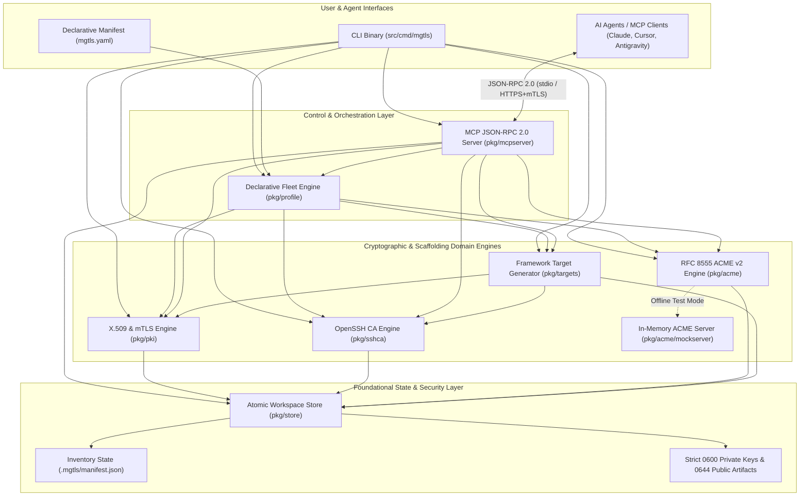
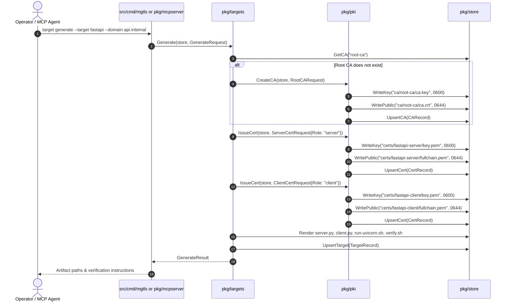
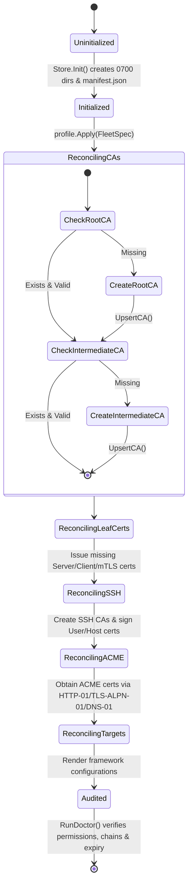

# System Architecture — `mgtls`

## 1. Purpose, Problem Statement & Design Philosophy

### Why `mgtls` Exists
Modern infrastructure requires zero-trust transport security everywhere—mutual TLS (mTLS) between microservices and AI Model Context Protocol (MCP) servers, trusted TLS certificates on hypervisors like Proxmox VE and local dev servers like Vite, and certificate-based OpenSSH authentication instead of static SSH keys. Yet provisioning these setups traditionally requires glueing together incompatible CLI tools (`openssl`, `ssh-keygen`, `certbot`, `keytool`) and manually translating certificate chains into framework-specific configurations.

**The core purpose of `mgtls`** is to unify the entire cryptographic lifecycle—from CA creation and ACME public issuance to framework-specific mTLS configuration scaffolding—into a single, deterministic, zero-CGO (`CGO_ENABLED=0`) Go 1.26 binary that serves three audiences simultaneously:
- **Developers & Sysadmins** via an ergonomic CLI (`mgtls ca`, `mgtls cert`, `mgtls ssh`, `mgtls acme`, `mgtls target`).
- **Platform & IaC/CI-CD Engineers** via declarative YAML/JSON state reconciliation (`mgtls apply -f mgtls.yaml` & `mgtls doctor`).
- **Autonomous AI Agents & Toolchains** via a built-in Model Context Protocol (MCP) JSON-RPC 2.0 server (`mgtls mcp serve` over `stdio` and mTLS-authenticated HTTPS).

### Core Subsystem Responsibilities
`mgtls` provides deterministic lifecycle management across six domains:

1. **X.509 Public Key Infrastructure (`pkg/pki`)**: Root CAs, multi-tier Intermediate CAs, standalone self-signed certificates, Server/Client/Dual mutual TLS (mTLS) leaf certificates, Certificate Revocation Lists (CRLs), PKCS#12/DER exports, and OS trust store provisioning scripts.
2. **OpenSSH Certificate Authorities (`pkg/sshca`)**: Dedicated SSH User CAs and SSH Host CAs, OpenSSH v01 certificate signing (`*-cert.pub`), certificate inspection, and automated `sshd_config`/`ssh_config`/`authorized_principals`/`known_hosts` configuration bundles.
3. **RFC 8555 ACME v2 Public Encryption (`pkg/acme`)**: Automated issuance from Let's Encrypt (Production & Staging), ZeroSSL, Buypass, Google Trust Services, and custom ACME directories via HTTP-01, TLS-ALPN-01 (`1.3.6.1.5.5.7.1.31`), and DNS-01 challenges, backed by a built-in RFC 8555 mock ACME server (`pkg/acme/mockserver`) for offline verification.
4. **Target Framework & Server Scaffolding (`pkg/targets`)**: Ready-to-run TLS and mTLS configurations, application templates, and verification harnesses for Python FastAPI, Spring Boot 3, MCP Servers, NGINX, Vite, Proxmox VE, and OpenSSH.
5. **Declarative Fleet Management (`pkg/profile`)**: Idempotent state reconciliation (`mgtls apply -f mgtls.yaml`) and automated fleet diagnostics (`mgtls status`, `mgtls doctor`).
6. **Agentic MCP Server (`pkg/mcpserver`)**: Standards-compliant Model Context Protocol (MCP) server (`mgtls mcp serve`) over `stdio` and HTTP/HTTPS (with optional self-hosted mTLS client verification).

---

## 2. High-Level System Architecture



---

## 3. Package Boundaries & Dependency Graph

`mgtls` enforces a strict directed acyclic graph (DAG) across packages to prevent circular dependencies and isolate file-system mutations within `pkg/store`.

| Package | Responsibility | Internal Dependencies | External / Stdlib Dependencies |
| :--- | :--- | :--- | :--- |
| `pkg/store` | Workspace directory initialization (`0700`), private key writes (`0600`), public artifact writes (`0644`), concurrency locking, and atomic `manifest.json` persistence. | None | `encoding/json`, `os`, `path/filepath`, `sync`, `time` |
| `pkg/pki` | Root & Intermediate X.509 CAs, self-signed certs, Server/Client/mTLS leaf certs, SAN encoding, CRL v2 generation, PKCS#12/DER export, chain verification, OS trust store scripts. | `pkg/store` | `crypto/ecdsa`, `crypto/ed25519`, `crypto/rsa`, `crypto/x509`, `encoding/pem`, `encoding/asn1` |
| `pkg/sshca` | OpenSSH User & Host CA creation, keypair generation, OpenSSH v01 certificate signing (`SSH_CERT_TYPE_USER`, `SSH_CERT_TYPE_HOST`), inspection, and `sshd_config`/`ssh_config` bundles. | `pkg/store` | `golang.org/x/crypto/ssh`, `crypto/ed25519`, `crypto/ecdsa`, `crypto/rsa` |
| `pkg/acme` | RFC 8555 ACME v2 client, JWS ES256 request signing, Replay-Nonce tracking, External Account Binding (EAB HS256), HTTP-01, TLS-ALPN-01, DNS-01 solvers, provider catalog. | `pkg/store` | `crypto/ecdsa`, `crypto/hmac`, `crypto/tls`, ` crypto/x509`, `net/http` |
| `pkg/acme/mockserver` | Deterministic in-memory RFC 8555 ACME v2 directory, nonce, account, order, authorization, challenge, finalize, and certificate issuance server. | None | `crypto/x509`, `net/http/httptest` |
| `pkg/targets` | Framework scaffolding (`fastapi`, `springboot`, `mcp`, `nginx`, `vite`, `proxmox`, `openssh`), automated certificate provisioning, and runnable verification scripts. | `pkg/store`, `pkg/pki`, `pkg/sshca` | `text/template`, `path/filepath` |
| `pkg/profile` | Declarative `mgtls.yaml` / JSON parser, idempotent convergence engine (`Apply`), and store health/expiry diagnostics (`RunDoctor`). | `pkg/store`, `pkg/pki`, `pkg/sshca`, `pkg/acme`, `pkg/targets` | `gopkg.in/yaml.v3`, `encoding/json` |
| `pkg/mcpserver` | Model Context Protocol (MCP) JSON-RPC 2.0 server (`stdio` and `http`/`https`/mTLS), exposing Tools, Resources, and Prompts. | `pkg/store`, `pkg/pki`, `pkg/sshca`, `pkg/acme`, `pkg/targets`, `pkg/profile` | `encoding/json`, `net/http`, `crypto/tls` |
| `src/cmd/mgtls` | CLI entrypoint, subcommand routing, flag parsing, tabular human output, and `--json` structured output. | All `pkg/*` | `flag`, `fmt`, `os` |

---

## 4. Component-Level Sequence Flows

### 4.1 Multi-Tier mTLS Provisioning & Target Generation Flow



### 4.2 Declarative Reconciliation & Atomic State Machine



---

## 5. On-Disk Storage Layout & Permission Model

By default, `mgtls` stores state in `.mgtls/` (override via `--store-dir` or `MGTLS_STORE_DIR`). Every directory and file created by `pkg/store` enforces deterministic POSIX file permissions:

```text
.mgtls/                                   [0700 drwx------]
├── manifest.json                         [0600 -rw-------] (Atomically updated via manifest.json.tmp)
├── ca/                                   [0700 drwx------]
│   ├── root-ca/                          [0700 drwx------]
│   │   ├── ca.key                        [0600 -rw-------] (Private key: Ed25519 / ECDSA / RSA)
│   │   ├── ca.crt                        [0644 -rw-r--r--] (Self-signed Root CA PEM)
│   │   ├── ca-chain.pem                  [0644 -rw-r--r--] (CA certificate chain)
│   │   ├── crl.pem                       [0644 -rw-r--r--] (X.509 v2 CRL)
│   │   └── trust/                        [0755 drwxr-xr-x] (OS trust installation scripts)
│   └── intermediate-ca/                  [0700 drwx------]
│       ├── ca.key                        [0600 -rw-------]
│       ├── ca.crt                        [0644 -rw-r--r--]
│       └── ca-chain.pem                  [0644 -rw-r--r--] (Intermediate + Root PEM)
├── certs/                                [0700 drwx------]
│   └── <cert-name>/                      [0700 drwx------]
│       ├── key.pem                       [0600 -rw-------] (Leaf private key)
│       ├── cert.pem                      [0644 -rw-r--r--] (Leaf X.509 certificate)
│       ├── fullchain.pem                 [0644 -rw-r--r--] (Leaf + Intermediate CA chain)
│       ├── ca-chain.pem                  [0644 -rw-r--r--] (Issuing CA + Root CA chain)
│       ├── cert.der                      [0644 -rw-r--r--] (Binary DER certificate)
│       └── bundle.p12                    [0600 -rw-------] (PKCS#12 / PFX bundle)
├── ssh/                                  [0700 drwx------]
│   ├── ca/                               [0700 drwx------]
│   │   ├── <ca-name>                     [0600 -rw-------] (OpenSSH CA private key)
│   │   └── <ca-name>.pub                 [0644 -rw-r--r--] (OpenSSH CA public key)
│   ├── certs/                            [0700 drwx------]
│   │   ├── <cert-name>                   [0600 -rw-------] (Principal private key)
│   │   ├── <cert-name>.pub               [0644 -rw-r--r--] (Principal public key)
│   │   └── <cert-name>-cert.pub          [0644 -rw-r--r--] (Signed OpenSSH v01 certificate)
│   └── config/                           [0755 drwxr-xr-x]
│       ├── sshd_config.d/mgtls-ca.conf   [0644 -rw-r--r--]
│       ├── ssh_config.d/mgtls.conf       [0644 -rw-r--r--]
│       ├── authorized_principals         [0644 -rw-r--r--]
│       └── known_hosts                   [0644 -rw-r--r--]
├── acme/                                 [0700 drwx------]
│   ├── accounts/                         [0700 drwx------]
│   │   └── <provider>-account.key        [0600 -rw-------] (ACME ES256 account key)
│   └── certs/<order-name>/               [0700 drwx------]
│       ├── key.pem                       [0600 -rw-------]
│       └── fullchain.pem                 [0644 -rw-r--r--]
└── targets/                              [0700 drwx------]
    └── <target-name>/                    [0755 drwxr-xr-x] (Generated framework artifacts)
```

### Atomic Manifest State Transitions

All mutations to `.mgtls/manifest.json` follow a strict mutex-serialized, crash-safe write protocol implemented in `(*store.Store).saveManifestLocked`:

1. Acquire `s.mu.Lock()` in-process mutex.
2. Read and unmarshal `.mgtls/manifest.json` (initializing directory structure with mode `0700` if absent).
3. Upsert the target record (`CARecord`, `CertRecord`, `SSHCARecord`, `SSHCertRecord`, `ACMERecord`, or `TargetRecord`) matched by canonical `Name`.
4. Update `Manifest.UpdatedAt` to `time.Now().UTC()`.
5. Serialize formatted JSON to `.mgtls/manifest.json.tmp` with mode `0600`.
6. Execute atomic POSIX rename (`os.Rename(tmpPath, finalPath)`) over `.mgtls/manifest.json`.
7. Release `s.mu.Unlock()`.

---

## 6. Cryptographic Security & Threat Model

### 6.1 Threat Model & Mitigations

| Threat Vector | Risk | `mgtls` Architectural Mitigation |
| :--- | :--- | :--- |
| **Unprivileged Local Key Disclosure** | Another local user reads CA or leaf private keys from shared disk or `/tmp` | `Store.WriteKey` creates parent directories with `0700`, writes files with `0600`, and explicitly invokes `os.Chmod(full, 0600)` to override permissive process `umask` settings. `RunDoctor` audits all private key permissions and flags any violation. |
| **Manifest Corruption on Crash / SIGKILL** | Partial JSON write corrupts inventory state | All state updates write to `manifest.json.tmp` (`0600`) and perform an atomic POSIX `rename(2)` onto `manifest.json`. |
| **CA Privilege Escalation via Leaf Cert** | Compromised leaf certificate used to sign rogue certificates | Leaf certificates strictly enforce `BasicConstraintsValid: true, IsCA: false`. Intermediate CAs enforce `MaxPathLen: 0, MaxPathLenZero: true` by default so an Intermediate CA cannot mint unauthorized sub-CAs unless explicitly permitted. |
| **Cross-Role Certificate Misuse (Confusion Attack)** | Client mTLS certificate used to impersonate a TLS Server | Role-specific Extended Key Usage (EKU) enforcement: `server` certs contain only `ExtKeyUsageServerAuth`; `client` certs contain only `ExtKeyUsageClientAuth`; `VerifyChain` checks the expected role EKU during validation. |
| **SSH User Cert Used as Host Cert** | Attacker uses a signed user certificate to spoof an SSH daemon | OpenSSH certificates strictly bind `CertType: ssh.UserCert` (`1`) vs `ssh.HostCert` (`2`) inside the signed binary blob and use distinct User CA and Host CA keys. |
| **SSH Certificate Without Principal Restriction** | Valid user certificate grants root login | `SignSSHCert` requires explicit principals (e.g., `ubuntu`, `deploy`) and supports critical options (`force-command`, `source-address`) and least-privilege extensions. |
| **ACME Replay & MitM Attacks** | Replay of signed ACME requests or unauthorized domain validation | Full RFC 8555 JWS with one-time `Replay-Nonce` headers, ephemeral ECDSA P-256 account/leaf keys, SHA-256 key authorization digests, and critical `id-pe-acmeIdentifier` (`1.3.6.1.5.5.7.1.31`) verification for TLS-ALPN-01. |
| **Weak Cryptographic Primitives** | Legacy SHA-1, RSA-1024, or TLS 1.0/1.1 usage | Defaults to `ed25519` or `ecdsa-p256` across PKI and SSH CAs, enforces minimum RSA 2048/4096, signs SSH RSA certs with `rsa-sha2-512`, and configures TLS 1.2/1.3 across all generated target templates and the MCP HTTPS server. |
