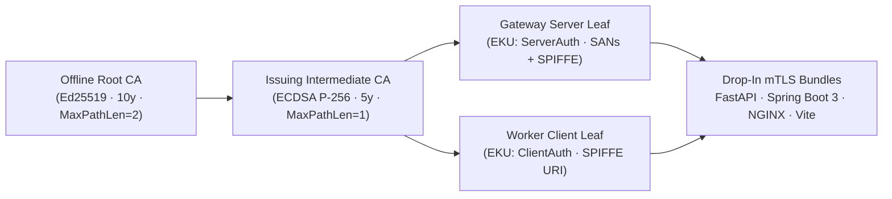

# `mgtls` Operational Cookbooks (`cookbooks/`)

This guide pairs step-by-step architectural recipes with runnable, self-contained executable scripts in [`cookbooks/`](../../cookbooks). Every cookbook script builds or invokes `mgtls` against an isolated temporary workspace (`mktemp -d`) so you can run them safely at any time.

---

## Cookbook Matrix

| # | Cookbook Script | Target Use Case | Key Subsystems |
| :- | :--- | :--- | :--- |
| **01** | [`cookbooks/01-local-pki-and-mtls-mesh.sh`](../../cookbooks/01-local-pki-and-mtls-mesh.sh) | Multi-Tier Local PKI (Offline Root CA → Intermediate CA) & Service Mesh mTLS (`FastAPI`, `Spring Boot 3`, `NGINX`, `Vite`) | `src/pkg/pki`, `src/pkg/targets` |
| **02** | [`cookbooks/02-mcp-agent-zero-trust-mtls.sh`](../../cookbooks/02-mcp-agent-zero-trust-mtls.sh) | Zero-Trust Model Context Protocol (MCP) Agent & Server mTLS Provisioning via JSON-RPC 2.0 | `src/pkg/mcpserver`, `src/pkg/pki` |
| **03** | [`cookbooks/03-openssh-zero-trust-ca-fleet.sh`](../../cookbooks/03-openssh-zero-trust-ca-fleet.sh) | OpenSSH User CA & Host CA Fleet Rollout (Zero-TOFU `@cert-authority` & Principal Auth) | `src/pkg/sshca`, `src/pkg/targets` |
| **04** | [`cookbooks/04-proxmox-and-acme-automation.sh`](../../cookbooks/04-proxmox-and-acme-automation.sh) | Proxmox VE Hypervisor (`pveproxy`) TLS Deployment & Free Public ACME v2 Automation | `src/pkg/acme`, `src/pkg/targets` |
| **05** | [`cookbooks/05-iac-and-cicd-integration.sh`](../../cookbooks/05-iac-and-cicd-integration.sh) | Declarative IaC (`mgtls.yaml`), Kubernetes TLS Secrets, Terraform State & CI/CD Gates | `src/pkg/profile`, `src/pkg/store` |

---

## Cookbook 01: Multi-Tier Local PKI & Service Mesh mTLS

**Executable:** `./cookbooks/01-local-pki-and-mtls-mesh.sh`

### Workflow Architecture



### Run It

```bash
./cookbooks/01-local-pki-and-mtls-mesh.sh
```

---

## Cookbook 02: Zero-Trust MCP Agent & Server mTLS

**Executable:** `./cookbooks/02-mcp-agent-zero-trust-mtls.sh`

Demonstrates how an AI agent or orchestrator communicates with `mgtls mcp serve --transport stdio` over JSON-RPC 2.0 to:
1. Initialize the MCP `2024-11-05` session.
2. Call `pki_create_ca` to create a dedicated `mcp-zero-trust-ca`.
3. Call `pki_issue_cert` for both `mcp-server-tls` (`role: server`) and `mcp-agent-client` (`role: client`, SPIFFE URI `spiffe://mcp.internal/agent/claude`).
4. Call `target_generate` (`target_type: mcp`) to emit TypeScript, Python, Claude Desktop/Cursor JSON, and NGINX mTLS sidecar configs.

```bash
./cookbooks/02-mcp-agent-zero-trust-mtls.sh
```

---

## Cookbook 03: OpenSSH Zero-Trust User & Host CA Fleet

**Executable:** `./cookbooks/03-openssh-zero-trust-ca-fleet.sh`

Replaces static `~/.ssh/authorized_keys` files and Trust-On-First-Use (`TOFU`) host prompts with cryptographic OpenSSH User & Host Certificate Authorities:
- **User CA (`SSH_CERT_TYPE_USER`)**: Signs short-lived (24-hour) user certificates bound to explicit principals (`sre,admin,deploy`) with `permit-pty` and `permit-port-forwarding`.
- **Host CA (`SSH_CERT_TYPE_HOST`)**: Signs bastion and workload host keys (`*-cert.pub`) trusted fleet-wide via a single `@cert-authority *.corp.internal,10.10.*.*` entry in `known_hosts`.

```bash
./cookbooks/03-openssh-zero-trust-ca-fleet.sh
```

---

## Cookbook 04: Proxmox VE Node TLS & Free Public ACME v2

**Executable:** `./cookbooks/04-proxmox-and-acme-automation.sh`

1. Displays all built-in free public RFC 8555 ACME v2 Certificate Authorities (`letsencrypt`, `letsencrypt-staging`, `zerossl`, `buypass`, `google`, `custom`).
2. Provisions a 397-day CA/Browser-Forum-compliant Proxmox VE node certificate (`pve01.lab.internal`, `192.168.10.10`).
3. Emits `deploy_proxmox_cert.sh` (`pvenode cert set fullchain.pem key.pem --force 1 --restart 1`), `proxmox_pveproxy_verify.sh`, and OS trust store installation scripts.

```bash
./cookbooks/04-proxmox-and-acme-automation.sh
```

---

## Cookbook 05: Declarative IaC & CI/CD Secret Bundle Provisioning

**Executable:** `./cookbooks/05-iac-and-cicd-integration.sh`

Reconciles a declarative `mgtls.yaml` manifest and exports ready-to-apply infrastructure artifacts:
- **Kubernetes `kubernetes.io/tls` + mTLS `ca.crt` Secret** (`ingress-mtls-secret.yaml`).
- **Terraform / Ansible JSON Inventory** (`mgtls status --json`).
- **Automated CI/CD Health Gate** (`mgtls doctor --warn-days 30`).

```bash
./cookbooks/05-iac-and-cicd-integration.sh
```
