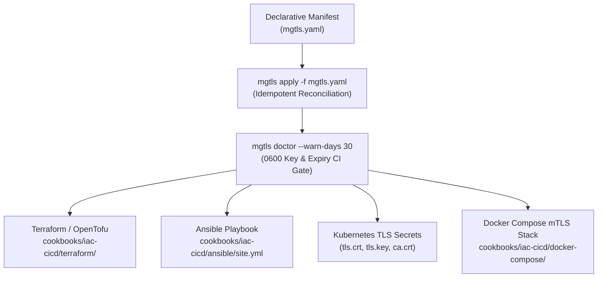

# Infrastructure-as-Code (IaC) & CI/CD Integration Guide

`mgtls` is designed from the ground up for deterministic, non-interactive execution inside **Terraform / OpenTofu**, **Ansible**, **Kubernetes**, **Docker Compose**, **GitHub Actions**, and **GitLab CI**.

---

## End-to-End IaC & CI/CD Pipeline Flow



---

## 1. Terraform & OpenTofu Integration (`cookbooks/iac-cicd/terraform/`)

Use the Terraform `external` data source bridge ([`cookbooks/iac-cicd/terraform/main.tf`](../../cookbooks/iac-cicd/terraform/main.tf) and [`mgtls-external.sh`](../../cookbooks/iac-cicd/terraform/mgtls-external.sh)) to provision CAs, mTLS certificates, and OpenSSH CAs during `terraform plan` / `terraform apply`:

```hcl
data "external" "mgtls_bundle" {
  program = ["bash", "${path.module}/mgtls-external.sh"]
  query = {
    store_dir      = ".mgtls-terraform"
    service_domain = "api.prod.internal"
  }
}

output "server_fullchain_path" {
  value = data.external.mgtls_bundle.result["server_fullchain_path"]
}
```

Test the external provider bridge directly from your shell:

```bash
echo '{"store_dir":"/tmp/tf-mgtls","service_domain":"api.prod.internal"}' | ./cookbooks/iac-cicd/terraform/mgtls-external.sh
```

---

## 2. Ansible Fleet Playbook (`cookbooks/iac-cicd/ansible/site.yml`)

[`cookbooks/iac-cicd/ansible/site.yml`](../../cookbooks/iac-cicd/ansible/site.yml) reconciles `/etc/mgtls/mgtls.yaml`, runs `mgtls doctor --warn-days 14` as a pre-deployment gate, and distributes OpenSSH User/Host CA keys and `sshd_config.d/50-mgtls-ca.conf` drop-ins across Linux hosts:

```bash
ansible-playbook -i inventory.ini cookbooks/iac-cicd/ansible/site.yml
```

---

## 3. Kubernetes `kubernetes.io/tls` Secret Generation

[`cookbooks/05-iac-and-cicd-integration.sh`](../../cookbooks/05-iac-and-cicd-integration.sh) demonstrates how to convert `mgtls` `fullchain.pem`, `key.pem`, and `ca-chain.pem` artifacts into a standard Kubernetes mTLS `Secret` compatible with NGINX Ingress Controller, Envoy, Traefik, and cert-manager consumers:

```yaml
apiVersion: v1
kind: Secret
metadata:
  name: ingress-mtls-tls
  labels:
    app.kubernetes.io/managed-by: mgtls
type: kubernetes.io/tls
data:
  tls.crt: <base64 fullchain.pem>
  tls.key: <base64 key.pem>
  ca.crt:  <base64 ca-chain.pem>
```

---

## 4. Docker Compose Zero-Trust mTLS Stack (`cookbooks/iac-cicd/docker-compose/`)

[`cookbooks/iac-cicd/docker-compose/docker-compose.mtls.yml`](../../cookbooks/iac-cicd/docker-compose/docker-compose.mtls.yml) mounts the `.mgtls` certificates and generated NGINX / MCP configurations directly into containerized services:

```bash
./bin/mgtls apply -f examples/fleet/mgtls.yaml
docker compose -f cookbooks/iac-cicd/docker-compose/docker-compose.mtls.yml config
```

---

## 5. CI/CD Pipeline Templates (`cookbooks/cicd/`)

To conserve CI minutes while providing drop-in pipeline definitions, reusable templates are provided in `cookbooks/cicd/`:

- **GitHub Actions**: [`cookbooks/cicd/github-actions-mgtls.yml`](../../cookbooks/cicd/github-actions-mgtls.yml) — builds the static `CGO_ENABLED=0` binary, runs `go test -race ./src/...`, reconciles `examples/fleet/mgtls.yaml`, and enforces `mgtls doctor --warn-days 30`.
- **GitLab CI**: [`cookbooks/cicd/gitlab-ci-mgtls.yml`](../../cookbooks/cicd/gitlab-ci-mgtls.yml) — 3-stage pipeline (`build`, `test`, `provision-mtls`) exporting `.mgtls-ci/` public CA and target bundles as job artifacts.
