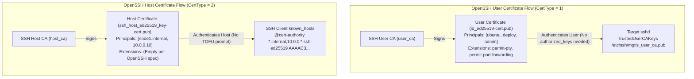
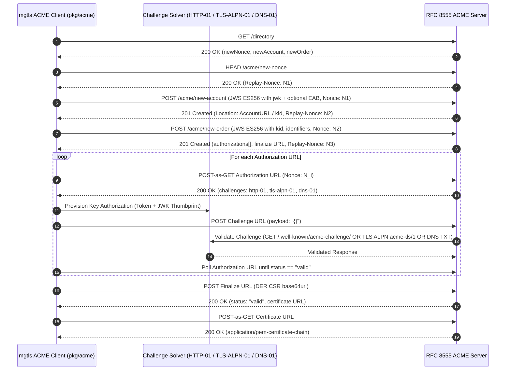

# Cryptographic & Protocol Specification — `mgtls`

## 1. X.509 PKI & Mutual TLS Specification (`pkg/pki`)

### 1.1 Supported Key Algorithms

`mgtls` supports five asymmetric key generation algorithms using pure Go `crypto/*` standard library implementations (`crypto/rand.Reader` CSPRNG):

| Algorithm Identifier | Key Type | Curve / Modulus | X.509 Signature Algorithm | Default Usage |
| :--- | :--- | :--- | :--- | :--- |
| `ed25519` (Default) | EdDSA | Curve25519 (RFC 8032) | `PureEd25519` (OID `1.3.101.112`) | Root CA, Intermediate CA, Leaf Certs |
| `ecdsa-p256` | ECDSA | NIST P-256 (`secp256r1`) | `ECDSAWithSHA256` (OID `1.2.840.10045.4.3.2`) | ACME Leaf/Account, Broad Browser/JVM mTLS |
| `ecdsa-p384` | ECDSA | NIST P-384 (`secp384r1`) | `ECDSAWithSHA384` (OID `1.2.840.10045.4.3.3`) | High-security Root/Intermediate CAs |
| `rsa-2048` | RSA | 2048-bit modulus ($e = 65537$) | `SHA256WithRSA` (OID `1.2.840.113549.1.1.11`) | Legacy appliance compatibility |
| `rsa-4096` | RSA | 4096-bit modulus ($e = 65537$) | `SHA384WithRSA` / `SHA256WithRSA` | Long-lived Root CAs |

All private keys are serialized in PKCS#8 (`PRIVATE KEY`) or algorithm-specific PEM blocks and persisted via `Store.WriteKey` with `0600` permissions.

---

### 1.2 Certificate Profiles, Key Usages & Path Length Constraints

Every certificate issued by `pkg/pki` uses a cryptographically random 128-bit positive serial number (`[1, 2^128 - 1]`), backdates `NotBefore` by 5 minutes to prevent clock-skew rejection, and computes a 160-bit SHA-1 or 256-bit SHA-256 `SubjectKeyId` (SKI) and `AuthorityKeyId` (AKI).

```mermaid
flowchart LR
    subgraph RootCA["Root CA (Self-Signed)"]
        R_BC["BasicConstraints: CA=TRUE"]
        R_PL["MaxPathLen: 1 (or N)"]
        R_KU["KeyUsage: CertSign | CRLSign | DigitalSignature"]
    end

    subgraph IntCA["Intermediate CA"]
        I_BC["BasicConstraints: CA=TRUE"]
        I_PL["MaxPathLen: 0 (MaxPathLenZero=TRUE)"]
        I_KU["KeyUsage: CertSign | CRLSign | DigitalSignature"]
    end

    subgraph Leaf["Leaf Certificate (Server / Client / mTLS)"]
        L_BC["BasicConstraints: CA=FALSE"]
        L_KU["KeyUsage: DigitalSignature | KeyEncipherment (RSA)"]
        L_EKU["ExtKeyUsage: serverAuth / clientAuth"]
        L_SAN["SubjectAltName: DNS, IP, URI, Email"]
    end

    RootCA -->|"Signs"| IntCA
    IntCA -->|"Signs"| Leaf
```



| Profile | `IsCA` | `MaxPathLen` | `KeyUsage` | `ExtKeyUsage` (EKU) |
| :--- | :--- | :--- | :--- | :--- |
| **Root CA** (`ParentCA == ""`) | `true` | `1` (configurable) | `KeyUsageCertSign \| KeyUsageCRLSign \| KeyUsageDigitalSignature` | None (unrestricted CA) |
| **Intermediate CA** (`ParentCA != ""`) | `true` | `0` (`MaxPathLenZero: true`) | `KeyUsageCertSign \| KeyUsageCRLSign \| KeyUsageDigitalSignature` | None (or constrained) |
| **Server Certificate** (`role: "server"`) | `false` | N/A | `KeyUsageDigitalSignature` (+ `KeyUsageKeyEncipherment` for RSA) | `ExtKeyUsageServerAuth` (`1.3.6.1.5.5.7.3.1`) |
| **Client Certificate** (`role: "client"`) | `false` | N/A | `KeyUsageDigitalSignature` (+ `KeyUsageKeyEncipherment` for RSA) | `ExtKeyUsageClientAuth` (`1.3.6.1.5.5.7.3.2`) |
| **Dual mTLS Certificate** (`role: "mtls"`) | `false` | N/A | `KeyUsageDigitalSignature` (+ `KeyUsageKeyEncipherment` for RSA) | `ExtKeyUsageServerAuth`, `ExtKeyUsageClientAuth` |
| **Self-Signed Certificate** | `false` | N/A | `KeyUsageDigitalSignature` (+ `KeyUsageKeyEncipherment` for RSA) | `ExtKeyUsageServerAuth`, `ExtKeyUsageClientAuth` |

---

### 1.3 Subject Alternative Name (SAN) Handling

Modern TLS implementations (RFC 6125, Chrome, Go `crypto/x509`, Java JSSE, Rustls) ignore the Subject `CommonName` (CN) for hostname matching and require Subject Alternative Names (OID `2.5.29.17`). `pkg/pki` populates SANs as follows:

1. **DNS Names (`DNSNames`)**: Any valid DNS label or wildcard (e.g., `localhost`, `api.internal`, `*.svc.cluster.local`).
2. **IP Addresses (`IPAddresses`)**: Parsed via `net.ParseIP` into 4-byte IPv4 (`127.0.0.1`) or 16-byte IPv6 (`::1`) records. If an entry passed in `DNSNames` parses as a valid IP address, it is automatically routed to `IPAddresses`.
3. **URIs (`URIs`)**: Parsed via `url.Parse` for SPIFFE IDs (e.g., `spiffe://cluster.local/ns/default/sa/api`) and MCP agent identities.
4. **Automatic Fallback**: If `CommonName` is a valid hostname or IP and no SANs are explicitly supplied, `mgtls` automatically injects `CommonName` into `DNSNames` or `IPAddresses` so the resulting certificate never fails RFC 6125 SAN validation.

---

### 1.4 Certificate Chain Assembly & Export Formats

When `IssueCert` executes, it produces a complete set of interoperable artifacts:

- `cert.pem`: Leaf certificate only (`-----BEGIN CERTIFICATE-----`).
- `key.pem`: Leaf private key (`0600`).
- `ca-chain.pem`: Ordered chain of issuing Intermediate CA(s) followed by the Root CA.
- `fullchain.pem`: Concatenation of `cert.pem` + Intermediate CA(s) (and Root CA for self-contained local mTLS deployments).
- `cert.der`: Raw ASN.1 DER-encoded leaf certificate bytes.
- `bundle.p12` / `bundle.pfx`: Bundle containing private key, leaf certificate, and CA chain for JVM/Windows/macOS Keychain consumption.

---

### 1.5 CRL v2 Generation & Chain Verification Rules

#### X.509 v2 Certificate Revocation Lists (`RevokeCert`)
- Marks the target `CertRecord` as `Revoked = true` with `RevokedAt = time.Now().UTC()` in `manifest.json`.
- Collects all revoked serial numbers issued by the specified CA and constructs an `x509.RevocationList` (Version 2) signed by the CA private key using `x509.CreateRevocationList`.
- Writes the PEM-encoded CRL (`-----BEGIN X509 CRL-----`) to `.mgtls/ca/<ca-name>/crl.pem`.

#### Chain Verification (`VerifyChain`)
`VerifyChain(certPath, caBundlePath, crlPath, dnsName, role)` performs a 4-stage validation:
1. **Cryptographic Path Building**: Builds `x509.CertPool` roots and intermediates from `caBundlePath` (and any intermediate blocks in `certPath`) and invokes `leaf.Verify(x509.VerifyOptions)`.
2. **Hostname / IP Matching**: If `dnsName != ""`, verifies `leaf.VerifyHostname(dnsName)` against SAN `DNSNames` and `IPAddresses`.
3. **Role EKU Enforcement**:
   - `role == "server"` requires `x509.ExtKeyUsageServerAuth`.
   - `role == "client"` requires `x509.ExtKeyUsageClientAuth`.
   - `role == "mtls"` requires both `ExtKeyUsageServerAuth` and `ExtKeyUsageClientAuth`.
4. **CRL Revocation Check**: If `crlPath != ""`, parses `x509.ParseRevocationList`, verifies the CRL signature against the issuing CA, and checks that `leaf.SerialNumber` does not appear in `crl.RevokedCertificateEntries`.

---

## 2. OpenSSH Certificate Specification (`pkg/sshca`)

`mgtls` implements the OpenSSH `PROTOCOL.certkeys` v01 binary certificate format via `golang.org/x/crypto/ssh`.

### 2.1 Certificate Key Types

| CA / Principal Key Algorithm | OpenSSH Public Key Format | OpenSSH Signed Certificate Format (`*-cert.pub`) |
| :--- | :--- | :--- |
| `ed25519` (Default) | `ssh-ed25519` | `ssh-ed25519-cert-v01@openssh.com` |
| `ecdsa-p256` | `ecdsa-sha2-nistp256` | `ecdsa-sha2-nistp256-cert-v01@openssh.com` |
| `rsa-4096` / `rsa-2048` | `ssh-rsa` | `rsa-sha2-512-cert-v01@openssh.com` |

When signing with an RSA CA key, `mgtls` wraps the `ssh.Signer` with `ssh.NewSignerWithAlgorithms` enforcing `ssh.KeyAlgoRSASHA512` (`rsa-sha2-512`) so modern OpenSSH 8.8+ daemons (which deprecated `ssh-rsa` SHA-1 signatures) accept the certificate without fallback configuration.

---

### 2.2 User vs. Host Certificates



| Field | User Certificate (`SSH_CERT_TYPE_USER = 1`) | Host Certificate (`SSH_CERT_TYPE_HOST = 2`) |
| :--- | :--- | :--- |
| **CA Key** | Dedicated User CA (`ca_type: "user"`) | Dedicated Host CA (`ca_type: "host"`) |
| **KeyId** | User identifier (e.g., `alice@corp-2026`) | Host identifier (e.g., `pve01.internal`) |
| **ValidPrincipals** | OS usernames / role principals (e.g., `["root", "ubuntu", "deploy"]`) | Hostnames, FQDNs, and IPs (e.g., `["pve01.internal", "10.10.0.5"]`) |
| **CriticalOptions** | Optional: `force-command`, `source-address`, `verify-required` | Empty (`map[string]string{}`) |
| **Default Extensions** | `permit-pty`, `permit-port-forwarding`, `permit-agent-forwarding`, `permit-user-rc`, `permit-X11-forwarding` | Empty (`map[string]string{}` — OpenSSH rejects host certs with user extensions) |
| **sshd / ssh Config** | `TrustedUserCAKeys /etc/ssh/mgtls_user_ca.pub` | `HostCertificate /etc/ssh/ssh_host_key-cert.pub` + client `@cert-authority` |

---

## 3. RFC 8555 ACME v2 Protocol Specification (`pkg/acme`)

### 3.1 Built-in ACME Provider Catalog

| Provider ID | Name | Directory URL | EAB Required | Max Validity | Notes |
| :--- | :--- | :--- | :--- | :--- | :--- |
| `letsencrypt` | Let's Encrypt Production | `https://acme-v02.api.letsencrypt.org/directory` | No | 90 days | Rate-limited public production CA |
| `letsencrypt-staging` | Let's Encrypt Staging | `https://acme-staging-v02.api.letsencrypt.org/directory` | No | 90 days | High rate limit testing environment |
| `zerossl` | ZeroSSL | `https://acme.zerossl.com/v2/DV90` | Yes (HS256) | 90 days | Free EAB credentials via ZeroSSL API/portal |
| `buypass` | Buypass Go SSL | `https://api.buypass.com/acme/directory` | No | 180 days | Free 180-day certificates (HTTP-01 / DNS-01) |
| `google` | Google Trust Services | `https://dv.acme-v02.api.pki.goog/directory` | Yes (HS256) | 90 days | Requires Google Cloud Public CA EAB key |
| `custom` | Custom RFC 8555 CA | User-specified (`--directory-url`) | Optional | Varies | Compatible with Smallstep `step-ca`, Pebble, Boulder |

---

### 3.2 RFC 8555 State Machine & JWS Signing



#### JWS (JSON Web Signature) Construction
All POST requests use Content-Type `application/jose+json` with flattened JWS JSON serialization signed by an ECDSA P-256 (`ES256`) account key:
- **Protected Header (`newAccount`)**: `{"alg":"ES256","jwk":{...},"nonce":"<Replay-Nonce>","url":"<EndpointURL>"}`
- **Protected Header (Subsequent Calls)**: `{"alg":"ES256","kid":"<AccountURL>","nonce":"<Replay-Nonce>","url":"<EndpointURL>"}`
- **ECDSA Signature Format**: Concatenated 64-byte big-endian $R \parallel S$ (32 bytes each, zero-padded), encoded with unpadded `base64.RawURLEncoding`.

#### RFC 7638 JWK Thumbprint & Key Authorization
For an ECDSA P-256 account public key $(x, y)$, the canonical lexicographical JSON representation is:
```json
{"crv":"P-256","kty":"EC","x":"<base64url(X)>","y":"<base64url(Y)>"}
```
The JWK thumbprint is `base64url(SHA256(canonicalJWK))`, and the challenge Key Authorization string is:
$$\text{KeyAuth} = \text{token} \mathbin{\Vert} \text{"."} \mathbin{\Vert} \text{base64url}(\text{SHA256}(\text{canonicalJWK}))$$

#### External Account Binding (EAB)
For providers requiring EAB (`zerossl`, `google`), `mgtls` constructs a nested JWS inside `newAccount`:
- Inner Protected Header: `{"alg":"HS256","kid":"<EAB_KID>","url":"<newAccountURL>"}`
- Inner Payload: `base64url(AccountPublicJWK)`
- Inner Signature: `base64url(HMAC-SHA256(base64urlDecode(EAB_HMAC_Key), protected + "." + payload))`

---

### 3.3 ACME Challenge Solvers

#### 1. HTTP-01 (`http-01`)
- **Validation Path**: `http://<domain>:80/.well-known/acme-challenge/<token>`
- **Response Body**: Exact ASCII string `KeyAuth` (`Content-Type: application/octet-stream`).
- **Modes**:
  - **Built-in Ephemeral HTTP Listener**: Binds `HTTPAddr` (default `:80` or custom test port) during challenge validation.
  - **Webroot Mode (`WebrootDir`)**: Writes `<WebrootDir>/.well-known/acme-challenge/<token>` (`0644`) for existing NGINX/Caddy/Apache servers and cleans up upon completion.

#### 2. TLS-ALPN-01 (`tls-alpn-01` — RFC 8737)
- **ALPN Protocol Name**: `acme-tls/1`
- **Validation Certificate**: Ephemeral self-signed X.509 certificate generated for `<domain>` containing:
  - SAN `DNSNames`: `[<domain>]`
  - **Critical X.509 Extension**: OID `1.3.6.1.5.5.7.1.31` (`id-pe-acmeIdentifier`), marked `Critical: true`, whose value is the ASN.1 DER `OCTET STRING` (`0x04 0x20` + 32-byte `SHA256(KeyAuth)`).
- During the TLS handshake on port 443 (or configured `TLSAddr`), the built-in listener negotiates ALPN `acme-tls/1` and presents this validation certificate.

#### 3. DNS-01 (`dns-01`)
- **DNS Record Name**: `_acme-challenge.<domain>.`
- **DNS TXT Value**: `base64url(SHA256(KeyAuth))`
- **Automation Hook**: If `DNSCommand` is provided, `mgtls` executes the hook passing environment variables `MGTLS_ACME_DOMAIN`, `MGTLS_ACME_TOKEN`, `MGTLS_ACME_TXT_NAME` (`_acme-challenge.<domain>`), and `MGTLS_ACME_TXT_VALUE` before signaling challenge readiness to the ACME server.
