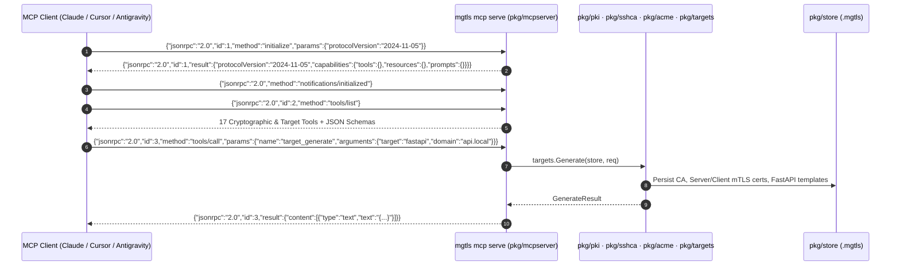

# Model Context Protocol (MCP) Server Specification — `mgtls`

## 1. Overview & Protocol Architecture

`mgtls` includes a built-in, standards-compliant Model Context Protocol (MCP) JSON-RPC 2.0 server (`pkg/mcpserver`) invoked via `mgtls mcp serve`. It enables AI coding agents, autonomous infrastructure controllers, and IDE integrations to provision Certificate Authorities, issue mTLS and OpenSSH certificates, obtain public ACME certificates, and scaffold framework configurations through strongly typed tool calls.

### Supported Transports

1. **Standard I/O (`stdio` — Default)**:
   - Reads newline-delimited JSON-RPC 2.0 messages from `stdin` and writes responses to `stdout`.
   - Zero network surface area; ideal for local IDE and CLI agent integrations (Claude Code, Claude Desktop, Cursor, Antigravity).
2. **HTTP / HTTPS / mTLS (`--http <addr>`)**:
   - Exposes `POST /mcp` (and `/`) accepting `application/json` JSON-RPC 2.0 requests, plus `GET /healthz`.
   - Supports TLS encryption (`--tls-cert`, `--tls-key`) and strict mutual TLS client verification (`--client-ca`) enforcing TLS 1.2+ and `tls.RequireAndVerifyClientCert`.
   - **Authentication is mandatory**: either mTLS (`--client-ca`) or a bearer token (`MGTLS_MCP_TOKEN` or `--token-file`, >= 32 chars, constant-time compared). `--insecure-no-auth` is accepted only for loopback addresses; plaintext HTTP is refused on non-loopback addresses.
   - Rejects requests with an `Origin` header (403), a non-`application/json` `Content-Type` (415), or a body over 10 MiB (413).
   - `acme_obtain.dns_exec_hook` / `skip_verify_tls` require `--allow-exec-hooks`.



---

## 2. JSON-RPC 2.0 Lifecycle Methods

| JSON-RPC Method | Description |
| :--- | :--- |
| `initialize` | Negotiates protocol version (`2024-11-05`) and returns server capabilities (`tools`, `resources`, `prompts`) and `serverInfo` (`name: "mgtls"`, `version: "1.0.0"`). |
| `notifications/initialized` | Client notification confirming initialization handshake completion. |
| `ping` | Health check returning `{}`. |
| `tools/list` | Returns the array of all 17 registered MCP tools and their JSON Schema `inputSchema` definitions. |
| `tools/call` | Executes a named tool with `arguments` and returns `content: [{"type": "text", "text": "<JSON>"}]` (plus `isError: true` on domain errors). |
| `resources/list` | Lists available state and catalog resources (`mgtls://store/manifest`, `mgtls://targets/catalog`, `mgtls://acme/providers`). |
| `resources/read` | Reads the current JSON payload of a resource by `uri`. |
| `prompts/list` | Lists guided multi-step workflow prompt templates. |
| `prompts/get` | Renders a parameterized prompt template for an agent workflow. |

---

## 3. Complete MCP Tools Reference

### 3.1 X.509 PKI & mTLS Tools (`pkg/pki`)

#### `pki_create_ca`
Creates a Root CA (`parent_ca` omitted) or an Intermediate CA signed by `parent_ca`.
```json
{
  "name": "pki_create_ca",
  "description": "Create a Root CA or Intermediate X.509 Certificate Authority in the store.",
  "inputSchema": {
    "type": "object",
    "required": ["name"],
    "properties": {
      "name": { "type": "string", "description": "Unique identifier for the CA (e.g., root-ca, int-ca)" },
      "common_name": { "type": "string", "description": "X.509 Subject Common Name" },
      "organization": { "type": "string", "description": "X.509 Subject Organization" },
      "parent_ca": { "type": "string", "description": "Parent CA name in store to sign an Intermediate CA (empty for Root CA)" },
      "algorithm": { "type": "string", "enum": ["ed25519", "ecdsa-p256", "ecdsa-p384", "rsa-2048", "rsa-4096"], "default": "ed25519" },
      "valid_days": { "type": "integer", "default": 3650 },
      "max_path_len": { "type": "integer", "description": "BasicConstraints MaxPathLen" }
    }
  }
}
```

#### `pki_issue_cert`
Issues a Server, Client, or Dual mTLS leaf certificate signed by a CA in the store.
```json
{
  "name": "pki_issue_cert",
  "description": "Issue an X.509 leaf certificate (server, client, or dual mTLS) signed by a managed CA.",
  "inputSchema": {
    "type": "object",
    "required": ["name", "ca_name"],
    "properties": {
      "name": { "type": "string", "description": "Unique certificate identifier in store" },
      "common_name": { "type": "string", "description": "Subject Common Name" },
      "ca_name": { "type": "string", "description": "Issuing CA name in store" },
      "role": { "type": "string", "enum": ["server", "client", "mtls"], "default": "server" },
      "algorithm": { "type": "string", "enum": ["ed25519", "ecdsa-p256", "ecdsa-p384", "rsa-2048", "rsa-4096"], "default": "ecdsa-p256" },
      "dns_names": { "type": "array", "items": { "type": "string" } },
      "ip_addresses": { "type": "array", "items": { "type": "string" } },
      "uris": { "type": "array", "items": { "type": "string" } },
      "valid_days": { "type": "integer", "default": 365 }
    }
  }
}
```

#### `pki_self_sign`
Generates a standalone self-signed certificate without requiring a separate CA.
```json
{
  "name": "pki_self_sign",
  "description": "Generate a standalone self-signed X.509 certificate.",
  "inputSchema": {
    "type": "object",
    "required": ["name"],
    "properties": {
      "name": { "type": "string" },
      "common_name": { "type": "string" },
      "algorithm": { "type": "string", "enum": ["ed25519", "ecdsa-p256", "ecdsa-p384", "rsa-2048", "rsa-4096"], "default": "ecdsa-p256" },
      "dns_names": { "type": "array", "items": { "type": "string" } },
      "ip_addresses": { "type": "array", "items": { "type": "string" } },
      "valid_days": { "type": "integer", "default": 365 }
    }
  }
}
```

#### `pki_inspect`
Parses and inspects a PEM certificate file on disk.
```json
{
  "name": "pki_inspect",
  "description": "Inspect an X.509 PEM certificate and return subject, issuer, SANs, EKUs, validity, and SHA-256 fingerprint.",
  "inputSchema": {
    "type": "object",
    "required": ["cert_path"],
    "properties": {
      "cert_path": { "type": "string", "description": "Path to PEM certificate file" }
    }
  }
}
```

#### `pki_verify`
Verifies a certificate chain against a CA bundle, optional CRL, hostname/IP SAN, and mTLS role EKU.
```json
{
  "name": "pki_verify",
  "description": "Verify an X.509 certificate chain against a CA bundle, optional CRL, DNS/IP SAN, and role EKU.",
  "inputSchema": {
    "type": "object",
    "required": ["cert_path", "ca_bundle_path"],
    "properties": {
      "cert_path": { "type": "string" },
      "ca_bundle_path": { "type": "string" },
      "crl_path": { "type": "string" },
      "dns_name": { "type": "string" },
      "role": { "type": "string", "enum": ["", "server", "client", "mtls"] }
    }
  }
}
```

#### `pki_revoke`
Revokes a certificate by name and regenerates the issuing CA's X.509 v2 CRL PEM.
```json
{
  "name": "pki_revoke",
  "description": "Revoke an issued certificate and update the CA's Certificate Revocation List (CRL).",
  "inputSchema": {
    "type": "object",
    "required": ["ca_name", "cert_name"],
    "properties": {
      "ca_name": { "type": "string" },
      "cert_name": { "type": "string" },
      "reason_code": { "type": "integer", "default": 0 }
    }
  }
}
```

---

### 3.2 OpenSSH Certificate Authority Tools (`pkg/sshca`)

#### `ssh_create_ca`
Creates an OpenSSH User CA or Host CA keypair.
```json
{
  "name": "ssh_create_ca",
  "description": "Create an OpenSSH User CA or Host CA keypair.",
  "inputSchema": {
    "type": "object",
    "required": ["name"],
    "properties": {
      "name": { "type": "string" },
      "ca_type": { "type": "string", "enum": ["user", "host"], "default": "user" },
      "algorithm": { "type": "string", "enum": ["ed25519", "ecdsa-p256", "rsa-4096"], "default": "ed25519" }
    }
  }
}
```

#### `ssh_sign_cert`
Signs a user or host SSH public key (generating a new keypair automatically if `pub_key_path` is omitted).
```json
{
  "name": "ssh_sign_cert",
  "description": "Sign an OpenSSH user or host certificate (-cert.pub) with principals and validity interval.",
  "inputSchema": {
    "type": "object",
    "required": ["name", "ca_name", "principals"],
    "properties": {
      "name": { "type": "string" },
      "ca_name": { "type": "string" },
      "cert_type": { "type": "string", "enum": ["user", "host"], "default": "user" },
      "key_id": { "type": "string" },
      "principals": { "type": "array", "items": { "type": "string" } },
      "valid_hours": { "type": "integer", "default": 720 },
      "pub_key_path": { "type": "string", "description": "Optional path to existing .pub key; generates new keypair if empty" },
      "algorithm": { "type": "string", "enum": ["ed25519", "ecdsa-p256", "rsa-4096"], "default": "ed25519" },
      "force_command": { "type": "string" },
      "source_address": { "type": "string" }
    }
  }
}
```

#### `ssh_inspect`
Inspects an OpenSSH `-cert.pub` certificate file.
```json
{
  "name": "ssh_inspect",
  "description": "Parse and inspect an OpenSSH v01 certificate (-cert.pub).",
  "inputSchema": {
    "type": "object",
    "required": ["cert_path"],
    "properties": {
      "cert_path": { "type": "string" }
    }
  }
}
```

#### `ssh_config_bundle`
Generates ready-to-deploy `sshd_config.d/mgtls-ca.conf`, `ssh_config.d/mgtls.conf`, `authorized_principals`, and `@cert-authority` `known_hosts` files.
```json
{
  "name": "ssh_config_bundle",
  "description": "Generate OpenSSH server and client CA trust configuration files.",
  "inputSchema": {
    "type": "object",
    "properties": {
      "user_ca_name": { "type": "string" },
      "host_ca_name": { "type": "string" },
      "host_pattern": { "type": "string", "default": "*.internal,10.0.0.*" },
      "principals": { "type": "array", "items": { "type": "string" } },
      "output_dir": { "type": "string" }
    }
  }
}
```

---

### 3.3 ACME v2 Public Encryption Tools (`pkg/acme`)

#### `acme_providers`
Returns the catalog of built-in free ACME v2 CAs (Let's Encrypt, ZeroSSL, Buypass, Google Trust Services, Custom).
```json
{
  "name": "acme_providers",
  "description": "List supported public ACME v2 Certificate Authorities and their directory URLs.",
  "inputSchema": {
    "type": "object",
    "properties": {}
  }
}
```

#### `acme_obtain`
Executes an RFC 8555 ACME v2 order via HTTP-01, TLS-ALPN-01, or DNS-01.
```json
{
  "name": "acme_obtain",
  "description": "Obtain a free public TLS certificate via RFC 8555 ACME v2 (HTTP-01, TLS-ALPN-01, or DNS-01).",
  "inputSchema": {
    "type": "object",
    "required": ["name", "domains"],
    "properties": {
      "name": { "type": "string" },
      "provider": { "type": "string", "enum": ["letsencrypt", "letsencrypt-staging", "zerossl", "buypass", "google", "custom"], "default": "letsencrypt" },
      "directory_url": { "type": "string" },
      "email": { "type": "string" },
      "domains": { "type": "array", "items": { "type": "string" } },
      "challenge_type": { "type": "string", "enum": ["http-01", "tls-alpn-01", "dns-01"], "default": "http-01" },
      "http_addr": { "type": "string" },
      "tls_addr": { "type": "string" },
      "webroot_dir": { "type": "string" },
      "dns_command": { "type": "string" },
      "eab_kid": { "type": "string" },
      "eab_hmac_key": { "type": "string" },
      "use_mock_server": { "type": "boolean", "description": "Use built-in RFC 8555 mock server for offline testing" }
    }
  }
}
```

---

### 3.4 Target Scaffolding & Declarative Fleet Tools (`pkg/targets`, `pkg/profile`, `pkg/store`)

#### `target_list`
Lists all 7 supported target frameworks (`fastapi`, `springboot`, `mcp`, `nginx`, `vite`, `proxmox`, `openssh`) and their generated artifact templates.

#### `target_generate`
Provisions CA + Server/Client mTLS (or SSH CA) certificates and generates drop-in framework code, configs, and verification scripts.
```json
{
  "name": "target_generate",
  "description": "Generate a complete TLS/mTLS or SSH CA setup for a target framework (fastapi, springboot, mcp, nginx, vite, proxmox, openssh).",
  "inputSchema": {
    "type": "object",
    "required": ["target"],
    "properties": {
      "name": { "type": "string" },
      "target": { "type": "string", "enum": ["fastapi", "springboot", "mcp", "nginx", "vite", "proxmox", "openssh"] },
      "domain": { "type": "string", "default": "localhost" },
      "port": { "type": "integer" },
      "ca_name": { "type": "string", "default": "root-ca" },
      "mtls": { "type": "boolean", "default": true },
      "output_dir": { "type": "string" }
    }
  }
}
```

#### `profile_apply`
Applies a declarative YAML/JSON manifest file (`mgtls.yaml`) idempotently.
```json
{
  "name": "profile_apply",
  "description": "Apply a declarative YAML/JSON fleet manifest (mgtls.yaml) to provision CAs, certs, SSH CAs, ACME certs, and targets.",
  "inputSchema": {
    "type": "object",
    "required": ["manifest_path"],
    "properties": {
      "manifest_path": { "type": "string" }
    }
  }
}
```

#### `store_status`
Returns the current `.mgtls/manifest.json` inventory across all CAs, leaf certificates, SSH CAs/certificates, ACME orders, and target bundles.

#### `store_doctor`
Audits the store for expiring certificates, missing files, and insecure private key permissions (`!= 0600`).
```json
{
  "name": "store_doctor",
  "description": "Run security, permission (0600), chain validity, and expiration diagnostics on the mgtls store.",
  "inputSchema": {
    "type": "object",
    "properties": {
      "warn_days": { "type": "integer", "default": 30 }
    }
  }
}
```

---

## 4. MCP Resources & Prompts

### 4.1 MCP Resources (`resources/list`, `resources/read`)

| Resource URI | MIME Type | Description |
| :--- | :--- | :--- |
| `mgtls://store/manifest` | `application/json` | Live JSON snapshot of `.mgtls/manifest.json` containing all managed CAs, certificates, SSH CAs/certs, ACME orders, and generated target bundles. |
| `mgtls://targets/catalog` | `application/json` | Catalog of all 7 supported target frameworks (`fastapi`, `springboot`, `mcp`, `nginx`, `vite`, `proxmox`, `openssh`), default ports, and generated files. |
| `mgtls://acme/providers` | `application/json` | Catalog of supported free ACME v2 Certificate Authorities, directory endpoints, EAB requirements, and challenge types. |

### 4.2 MCP Prompts (`prompts/list`, `prompts/get`)

| Prompt Name | Arguments | Purpose |
| :--- | :--- | :--- |
| `setup-mtls-service` | `target` (`fastapi`, `springboot`, `mcp`, `nginx`, `vite`), `domain` | Guides the agent through creating a multi-tier CA, issuing Server & Client mTLS certificates, generating the framework bundle, and verifying the chain. |
| `setup-ssh-ca` | `principals`, `host_pattern` | Guides the agent through creating SSH User & Host CAs, signing user and host keys, and generating `sshd_config`/`ssh_config` trust bundles. |
| `setup-proxmox-tls` | `node_domain`, `ca_name` | Guides the agent through issuing a SAN certificate for a Proxmox VE node and generating the `pvenode cert set` deployment bundle. |

---

## 5. Client Integration Configurations

### 5.1 Claude Code (`~/.claude.json` or `.mcp.json`)

```json
{
  "mcpServers": {
    "mgtls": {
      "command": "mgtls",
      "args": ["--store-dir", ".mgtls", "mcp", "serve"],
      "env": {}
    }
  }
}
```

### 5.2 Claude Desktop (`claude_desktop_config.json`)

```json
{
  "mcpServers": {
    "mgtls": {
      "command": "/usr/local/bin/mgtls",
      "args": ["--store-dir", "/Users/admin/.mgtls", "mcp", "serve"]
    }
  }
}
```

### 5.3 Cursor (`.cursor/mcp.json`)

```json
{
  "mcpServers": {
    "mgtls": {
      "command": "mgtls",
      "args": ["mcp", "serve"]
    }
  }
}
```

### 5.4 Google Antigravity (`mcp_config.json`)

```json
{
  "mcpServers": {
    "mgtls": {
      "command": "mgtls",
      "args": ["--store-dir", "/home/admin/.mgtls", "mcp", "serve"]
    }
  }
}
```

### 5.5 Remote HTTPS + mTLS MCP Server Deployment

Start the MCP server protected by mutual TLS:
```bash
mgtls target generate --target mcp --domain mcp.internal --output-dir ./mcp-certs
mgtls mcp serve \
  --http 0.0.0.0:8443 \
  --tls-cert .mgtls/certs/mcp-server/fullchain.pem \
  --tls-key .mgtls/certs/mcp-server/key.pem \
  --client-ca .mgtls/ca/root-ca/ca-chain.pem
```

Invoke a tool over mTLS using `curl`:
```bash
curl --silent --fail \
  --cacert .mgtls/ca/root-ca/ca-chain.pem \
  --cert .mgtls/certs/mcp-client/cert.pem \
  --key .mgtls/certs/mcp-client/key.pem \
  -H "Content-Type: application/json" \
  -d '{"jsonrpc":"2.0","id":1,"method":"tools/call","params":{"name":"store_status","arguments":{}}}' \
  https://mcp.internal:8443/mcp
```
